# gaia-dr4-multiplanet-bias

Simulations of Gaia DR4 epoch astrometry for stars with **more than one giant
planet**, to measure how unmodelled companions bias:

- planet **detection** and the **fitted orbits** (period, mass, eccentricity);
- the choice between the orbit models that DR4 publishes (one orbit, orbit +
  acceleration, orbit + jerk, two orbits);
- the giant-planet **occurrence rate** and **planet yield** inferred from DR4;
- **RUWE**, and which DR4 quantities warn that a solution may be wrong;
- the **radial-velocity effort** needed to confirm DR4 planets or find hidden
  companions.

The code builds on [gaiamock](https://github.com/kareemelbadry/gaiamock)
(El-Badry et al. 2024) for the Gaia scanning law, noise model and orbit
optimiser, and is validated against the DR4 yield forecast of Lammers & Winn
(2026, AJ 171, 18, https://doi.org/10.3847/1538-3881/ae21de),
which assumes at most one planet per star.

The full description of the method, every assumption and the reference results
is in **[docs/METHODS_AND_RESULTS.md](docs/METHODS_AND_RESULTS.md)**. Changes between
versions are listed in **[CHANGELOG.md](CHANGELOG.md)**.

---

## Contents

1. [Installation](#1-installation)
2. [What to run, in order](#2-what-to-run-in-order)
3. [Run time, resuming and clusters](#3-run-time-resuming-and-clusters)
4. [Changing the assumptions](#4-changing-the-assumptions)
5. [Repository layout](#5-repository-layout)
6. [Conventions](#6-conventions)
7. [References](#7-references)

---

## 1. Installation

Requirements: Linux or macOS, Python ≥ 3.10, a C compiler and the GNU
Scientific Library (GSL), a few GB of free disk space (gaiamock's scan files,
the Gaia star download and the step 3 results), and internet access for the
one-off downloads.

### 1a. gaiamock (not pip-installable)

Put gaiamock **next to** this repository (or anywhere, and set `GAIAMOCK_DIR`):

```bash
# GSL: Fedora `sudo dnf install gsl-devel`, Debian/Ubuntu `sudo apt install libgsl-dev`,
#      macOS `brew install gsl`
git clone https://github.com/kareemelbadry/gaiamock
cd gaiamock
gcc -shared -fPIC -o kepler_solve_astrometry.so kepler_solve_astrometry.c -lgsl -lgslcblas -lm
# download healpix_scans.zip (link in gaiamock's README) and unzip it here,
# so that gaiamock/healpix_scans/ contains 49,152 files
cd ..
```

### 1b. This package

```bash
git clone <this repository> gaia-dr4-multiplanet-bias
cd gaia-dr4-multiplanet-bias
python -m venv .venv && source .venv/bin/activate
pip install -r requirements.txt
pip install -e .
```

If gaiamock is not in `../gaiamock`, tell the code where it is:

```bash
export GAIAMOCK_DIR=/path/to/gaiamock
```

### 1c. Check the installation

```bash
pytest                          # ~50 tests; the gaiamock ones are skipped if gaiamock is missing
python scripts/check_setup.py   # finds gaiamock, recovers one planet, times one fit
```

`check_setup.py` prints the number of scan files found (must be 49,152), one
injected planet and its fitted period and mass, a two-planet system fitted with
one planet, and the time per fit, from which it estimates how long a large run
takes on your machine.

---

## 2. What to run, in order

All commands run from the repository folder with the environment active.
Everything is written to `results/` (ignored by git). The figures below are the
outputs of the reference runs described in `docs/METHODS_AND_RESULTS.md`; your
numbers will differ slightly through random sampling.

| Step | Command | Needs | Rough cost* | Main outputs |
|---|---|---|---|---|
| 1 | `python scripts/step1_validate_single.py` | gaiamock | 3 core-h | `results/step1_single.png` |
| 2 | `python scripts/step2.py run`, then `plot` | gaiamock | 70 core-h | `results/step2_*.png`, `step2_summary.txt` |
| 3 | `python scripts/step3.py` | gaiamock, internet (first run) | 180 core-h | `results/step3_gaia/` |
| 4 | `python scripts/step4.py` | step 3 results | minutes | `results/step4/` |
| (opt.) | `python scripts/check_dr4_prerelease.py` | DR4 pre-release file | seconds | `results/dr4_prerelease/` |

\* CPU-core hours; divide by the number of cores for the wall-clock time. Steps
1 to 3 use all cores by default (`-j N` to limit). Steps 1, 2 and 4 are
independent of each other; step 4 needs step 3.

### Step 1 — single planets, validated against Lammers & Winn

```bash
python scripts/step1_validate_single.py -n 2000      # quick look
python scripts/step1_validate_single.py              # full run, 10,000 planets
python scripts/step1_validate_single.py --plot-only  # redo the figure from saved results
```

Injects one planet per star over a range of signal-to-noise ratio
(SNR₁ = a₀/σ per transit) and period, fits it, and applies the Lammers & Winn
detection rule (Δχ² > 50, mass < 13 M_J, constrained period).

**Expected:** `results/step1_single.png` and a printed summary. Detection rises
from 0 to ~1 between SNR₁ ≈ 1 and 3 (50% at SNR₁ ≈ 1.8); detection drops sharply
for periods beyond the 5.4-year data span; Δχ² follows ≈ 22 SNR₁², the DR4
relation of Lammers & Winn (their Eq. 31); fitted masses are biased high just
above the threshold (Eddington bias).

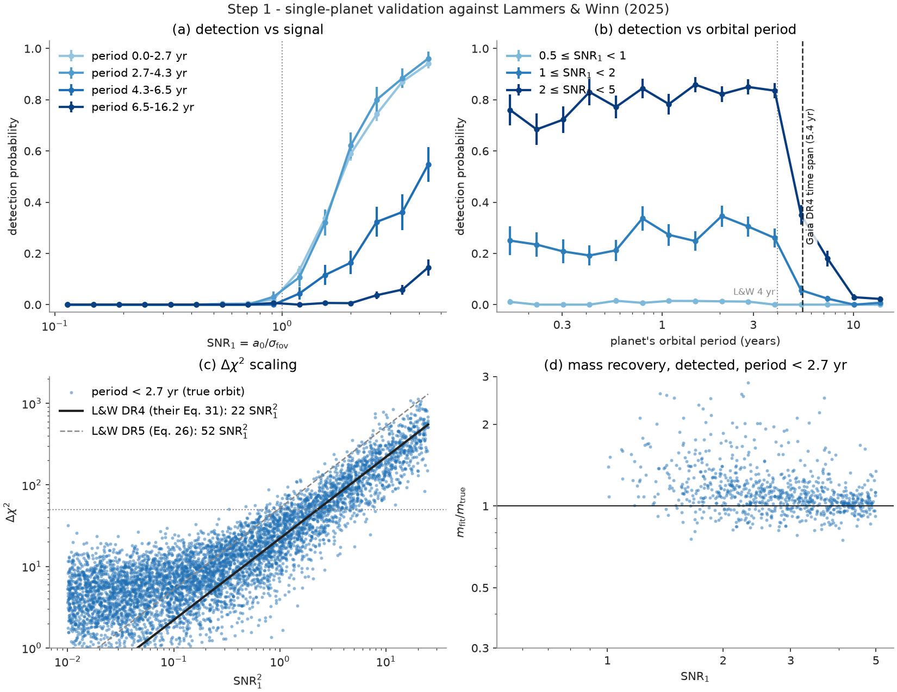

### Step 2 — one hidden companion, controlled experiment

```bash
python scripts/step2.py run -n 3000   # first 3,000 systems (about 1/7 of the cost)
python scripts/step2.py run           # all 20,000 systems; resumes where it stopped
python scripts/step2.py plot          # summary + figures from whatever is finished
# optional
python scripts/step2.py sweeps --baseline outer   # one parameter varied at a time
python scripts/step2.py maps                      # period x wobble maps at fixed eccentricity
python scripts/step2.py examples                  # MCMC posteriors for three example stars
```

Each simulated system has a **target** planet that Gaia could detect on its own
and a **companion** with a period from 30 days to 54 years and an astrometric
wobble from 1/100 to 100 times the target's. Every system is analysed twice,
with identical observation times and noise — with the target alone and with
both planets — using the one-orbit, orbit + acceleration, orbit + jerk and
two-orbit models, and the model with the lowest BIC (a stand-in for DR4's model
choice). Add `--quick` to `sweeps`, `maps` or `examples` for a short smoke test.

**Expected:** `results/step2_summary.txt` and four figures.

- `step2_overview.png` — the main result: where the reported planet is wrong
  (a), how the companion changes detection (b), recovery of the target by
  each analysis (c), what each analysis reports (d), how many wrong planets
  DR4's significance label would flag (e), and which other properties matter (f).
  Expect detection of the target to fall from ~80% alone to ~69% with the
  companion (one-orbit fit), and ~19% of reported planets to match neither
  planet, concentrated at companion periods near the data span and companions
  with larger wobbles.

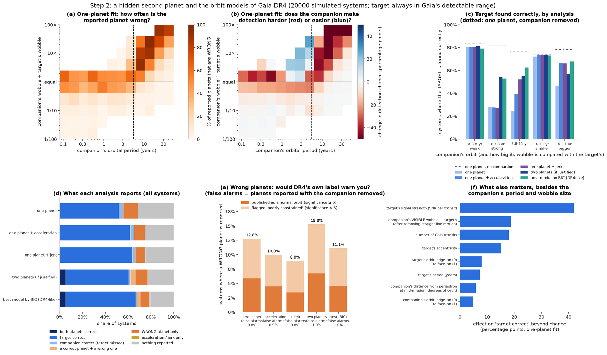

- `step2_maps.png` — the same maps for every analysis: target found correctly
  (top) and wrong planets (bottom), versus companion period and wobble ratio.

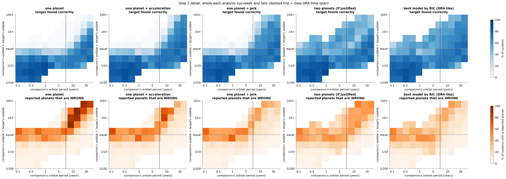

- `step2_outcomes.png` — outcomes for each companion type and analysis, and
  whether the Gaia DR3 goodness-of-fit cut (F2 < 25) would catch the wrong
  planets (expect: almost never).
- `step2_factors.png` — how much each other property (signal strength,
  number of transits, eccentricity, orientation, ...) changes the chance of
  finding the target, beyond what the companion's period and wobble explain.

<details><summary>Show step2_outcomes.png and step2_factors.png</summary>

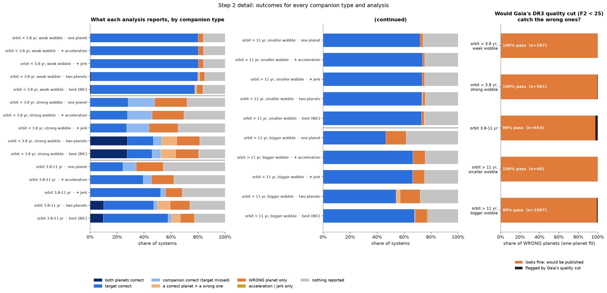
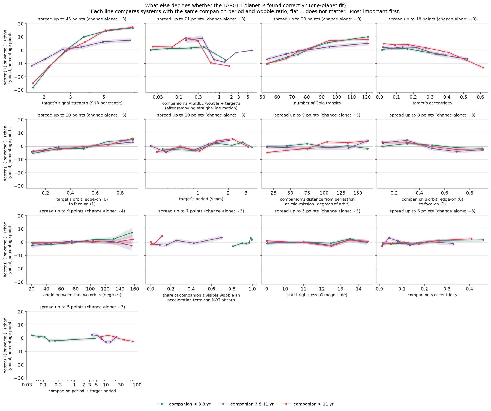

</details>

### Step 3 — real Gaia stars: occurrence rates, yield and RUWE

```bash
python scripts/step3.py --download-only   # optional: fetch the stars first (network-bound)
python scripts/step3.py                   # download (if needed), build, fit, analyse
python scripts/step3.py --analyse         # redo the summary and figures only
```

1. **Stars.** Downloads Gaia DR3 stars closer than 250 pc (parallax S/N > 10)
   in random 3° circles covering 25% of the sky (`--sky-fraction`, up to 0.52),
   from CDS VizieR or the ESA Gaia archive, into `data/gaia_dr3_250pc/`. The
   download resumes if interrupted. The Lammers & Winn selection (main
   sequence, their distance limit) and RUWE ≤ 1.4 are then applied (about
   580,000 stars for 25% of the sky).
2. **Planets.** A random subset of stars (`--stars`, default 300,000) receives
   giant planets (0.3–13 M_J, 0.1–30 au) from the California Legacy Survey
   occurrence model, under two multiplicity scenarios with the same mean number
   of giants per star: *independent* and *clustered* (calibrated on the
   outer-companion rate of Bryan et al. 2016). All multi-planet systems are
   Hill-stable.
3. **Fits.** Every star with planets is fitted with all its planets (A) and with
   each planet alone (B); 15,000 single-planet injections give the completeness
   (`--inj-fits`), and planet-free stars give the RUWE of single stars.
4. **Analysis.** Occurrence rates per mass–period bin and as a forward-modelled
   power law, compared with the true rate; RUWE; and a **multiplicity scan**
   (bias and yield versus the fraction of giant hosts with a second giant),
   built by reweighting the existing fits, so no new fits are needed.

**Expected:** `results/step3_gaia/summary.txt`, `multiplicity_scan.csv` and
five figures.

- `step3_multiplicity.png` — the main result. Left: inferred ÷ true
  occurrence rate over the whole giant-planet range; the one-orbit (Lammers &
  Winn-like) analysis drifts low as multiplicity increases (≈ 0.6 at 80%),
  the BIC choice much less. Centre: in the well-measured bins (3–13 M_J,
  1–8 yr) the bias stays within ~0–8%. Right: DR4 yield for the whole sky
  within 250 pc versus multiplicity, with the Lammers & Winn prediction for
  comparison.

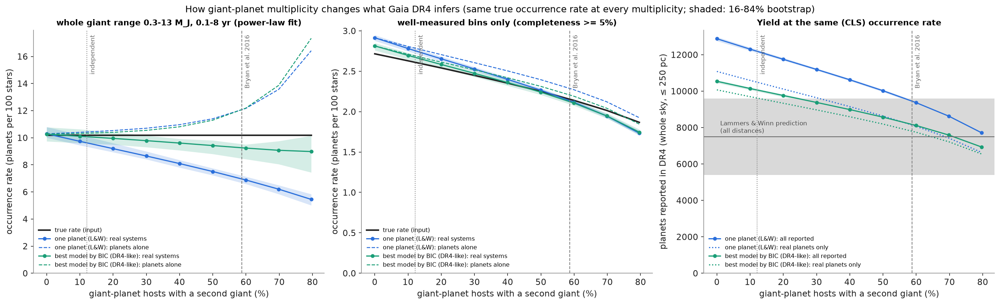

- `step3_overview.png` — rates in the well-measured bins for the two scenarios
  and every analysis (real systems A vs planets alone B vs truth), and the share
  of reported planets that are imprecise or spurious.

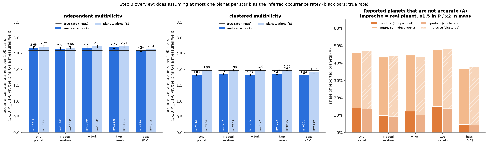

- `step3_rates.png` (and `step3_rates_all.png`, all analyses) — occurrence
  rate per period bin against the truth; bins with low completeness are shown
  as open grey circles.
- `step3_ruwe.png` — RUWE of stars with no planet, one giant and several
  giants; expect planets alone to push RUWE above 1.4 for only ~1% of hosts.

<details><summary>Show step3_rates.png and step3_ruwe.png</summary>

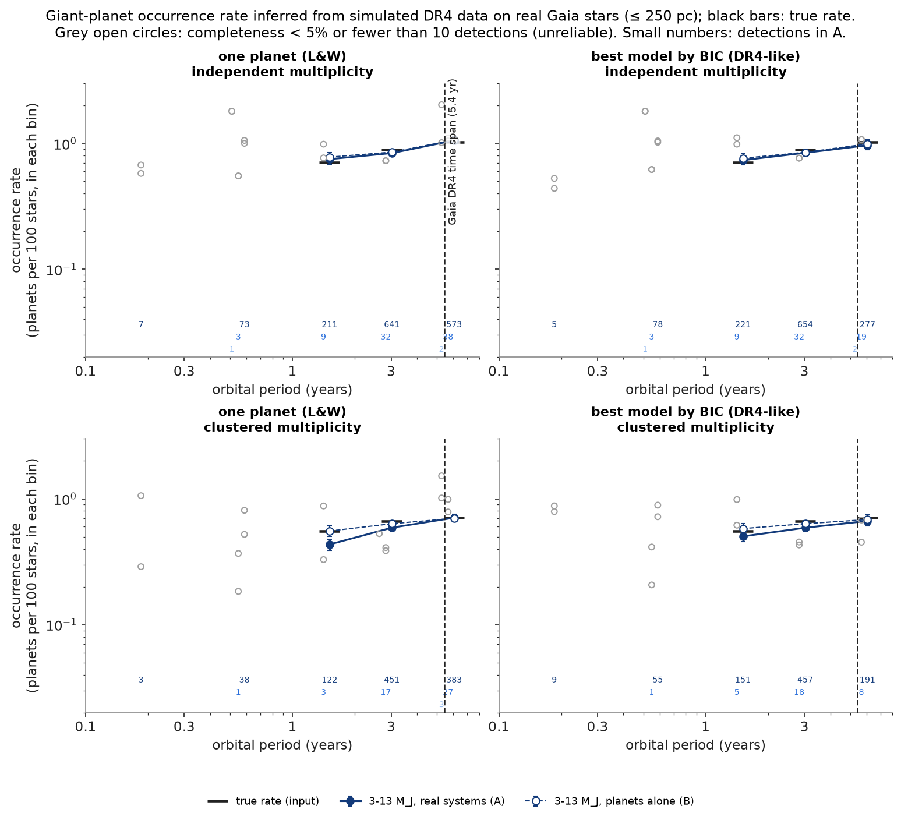
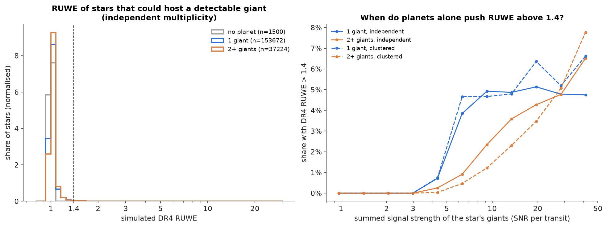

</details>

### Step 4 — warning flags and radial-velocity follow-up

```bash
python scripts/step4.py                      # uses results/step3_gaia/
python scripts/step4.py --baseline 2         # 2-year RV programme instead of 3
python scripts/step4.py --root path/to/step3_results --out path/to/output
```

Uses only the step 3 fits. Part 1 tests flags that a DR4 user can see (adopted
model, significance < 5, period > 0.7 × time span, eccentricity > 0.5, Δχ² near
threshold, period error, RUWE) against the truth. Part 2 estimates RV
semi-amplitudes, V magnitudes and the number of HARPS or FEROS epochs needed to
confirm each DR4 planet, reject spurious ones, and find hidden giants (instrument
assumptions in `src/gaiabias/rv.py`).

**Expected:** `results/step4/summary.txt`, `planets.csv` and two figures.

- `step4_flags.png` — for each flag: the share of reported planets that are
  not accurate, the share whose star hides another giant, and the share of all
  inaccurate planets the flag catches. The combined "suspect" flag catches
  roughly three quarters of inaccurate planets; a high RUWE is *not* a warning
  sign.

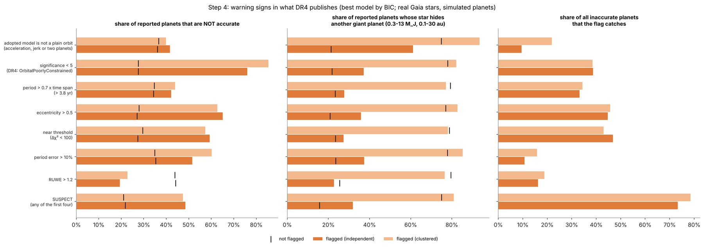

- `step4_rv.png` — share of stars where RV confirms the Gaia planet and where
  it finds the hidden giant, versus the number of epochs, and the RV signal of
  the hidden giants against V magnitude with the instrument limits.

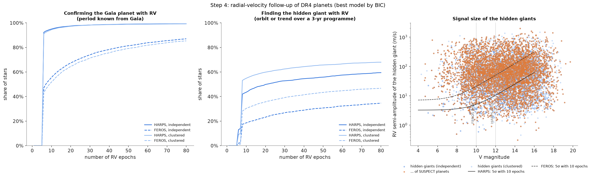

### Extended analyses — robustness tests and forecasts (version 0.2.0)

`scripts/extended/` adds tests of the step 2 and step 3 results and forecasts for follow-up:
step 2 outcomes as mutually exclusive categories, less favourable noise models, Bayesian
evidence against the BIC choice, an occurrence rate without an assumed power law, the
multiplicity signal in the mix of DR4 solutions, an N-body check of every simulated planet
pair, the warning flags on held-out stars and with brown-dwarf and stellar-binary
contaminants, a census of known inner-planet hosts with their DR4 sensitivity to outer
giants, what DR4 measures as full orbits or accelerations, and RV campaigns from La Silla.
They need `pip install -r requirements-extended.txt` (rebound, dynesty); see
[scripts/extended/README.md](scripts/extended/README.md) for what to run and
[docs/METHODS_AND_RESULTS.md](docs/METHODS_AND_RESULTS.md) for the results.

### Optional — check against real DR4 data

The Gaia DR4 epoch-astrometry pre-release (12 sources) can be used to test the
noise model, the independence of CCD measurements within a transit, and the
fitter on real orbits. Download the pre-release XML from
<https://www.cosmos.esa.int/web/gaia/dr4-prerelease> into `data/dr4_prerelease/`
and run:

```bash
python scripts/check_dr4_prerelease.py
```

**Expected:** a printed summary (formal errors within 5–10% of the noise model
at G = 14–20; within-transit correlation consistent with zero; published orbits
of HD 114762, Gaia-4 and Gaia BH3 recovered) and
`results/dr4_prerelease/dr4_prerelease_check.png`.

---

## 3. Run time, resuming and clusters

- **Resuming.** Steps 1 to 3 write each finished fit to disk; rerunning the
  same command continues where it stopped.
- **Run time** grows linearly with the number of fits. `check_setup.py`
  measures the time per fit on your machine. In step 3 the number of fits is
  about 8% of the stars per multiplicity scenario, plus the injections.
- **Bigger samples.** `--stars 578498` uses every selected star in the default
  sky area. For a larger `--sky-fraction`, delete
  `data/gaia_dr3_250pc/stars.npz` and rerun: the circles already downloaded
  are kept and only the new ones are fetched. The full sky within 250 pc (~2.3 million
  selected stars) is about eight times the default cost.
- **Clusters.** Step 3 can be split into independent jobs:

  ```bash
  python scripts/step3.py --part 0/20   # on job 0 ... up to --part 19/20 on job 19
  # copy all results/step3_gaia/fits.part*.csv into one results/step3_gaia/, then
  python scripts/step3.py --merge-parts
  ```

  Each job needs the same code, the same `data/` folder and gaiamock.
- **Disk.** A default step 3 run writes ~100 MB to `results/step3_gaia/`.

---

## 4. Changing the assumptions

| What | Where |
|---|---|
| Occurrence model and multiplicity scenarios | `src/gaiabias/population.py` |
| Noise model and observing pattern | `src/gaiabias/simulate.py`, `src/gaiabias/epochs.py` |
| Detection rule and orbit fits | `src/gaiabias/fitting.py`, `src/gaiabias/step2/outcomes.py` |
| Star selection and download | `src/gaiabias/gaia_stars.py` |
| Rate estimators | `src/gaiabias/rates.py` |
| Multiplicity scan grid | `SCAN_F` in `scripts/step3.py` |
| Warning flags | `FLAGS` in `scripts/step4.py` |
| Radial-velocity instruments and jitter | `src/gaiabias/rv.py` |

Every script prints its options with `--help`.

---

## 5. Repository layout

```
src/gaiabias/
  orbits.py            Keplerian orbits, Thiele-Innes <-> Campbell elements, mass from a0, stability
  simulate.py          epoch astrometry for a star with N companions, Gaia noise model
  epochs.py            Gaia observation times and scan angles (via gaiamock)
  fitting.py           no-companion, one-orbit, acceleration, jerk and two-orbit fits; BIC; RUWE
  gaiamock_bridge.py   locates and imports gaiamock
  population.py        occurrence model and multiplicity scenarios
  gaia_stars.py        download and selection of real Gaia DR3 stars
  rates.py             completeness and occurrence-rate estimators
  multiplicity.py      reweighting for the multiplicity scan
  rv.py                radial-velocity amplitudes, precision and epochs
  dr4_epoch.py         reader for DR4 epoch astrometry files
  step2/               simulation, analyses, sweeps and plots of step 2
  plotstyle.py         shared figure style
scripts/               one script per step (see Section 2)
scripts/extended/      robustness tests and forecasts (version 0.2.0; own README)
tests/                 unit tests (numpy/scipy only) and gaiamock integration tests
docs/                  methods and results; example figures
```

---

## 6. Conventions

Times in years from the data-release reference epoch; periods and periastron
times in days; angles in radians; astrometry in mas. Thiele–Innes and
along-scan conventions are identical to gaiamock's, so simulated data can be
passed directly to its fitter (checked in `tests/`).

---

## 7. References

- Lammers, C. & Winn, J. N. 2026, AJ 171, 18 — DR4 planet yield, detection rule, star selection ([arXiv:2511.04673](https://arxiv.org/abs/2511.04673)).
- El-Badry, K. et al. 2024 — gaiamock ([github.com/kareemelbadry/gaiamock](https://github.com/kareemelbadry/gaiamock); [arXiv:2411.00088](https://arxiv.org/abs/2411.00088)).
- Holl, B. et al. 2023, A&A 674, A10 — Gaia DR3 astrometric orbit processing and noise.
- Fulton, B. J. et al. 2021, ApJS 255, 14 — California Legacy Survey occurrence rates.
- Bryan, M. L. et al. 2016, ApJ 821, 89 — outer companions of giant-planet hosts.
- Kipping, D. M. 2013, MNRAS 434, L51 — eccentricity distribution.
- Gladman, B. 1993, Icarus 106, 247 — two-planet stability.
- Riello, M. et al. 2021, A&A 649, A3 — Gaia photometric relations.

The complete list is in [docs/METHODS_AND_RESULTS.md](docs/METHODS_AND_RESULTS.md).
