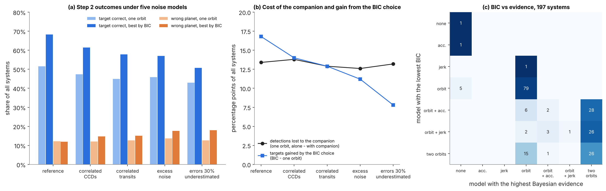
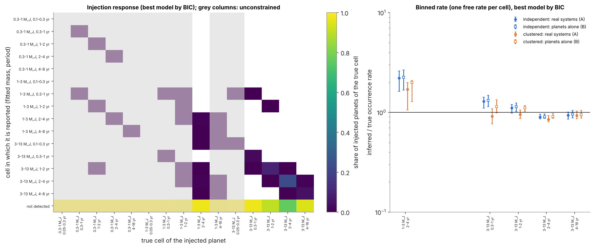
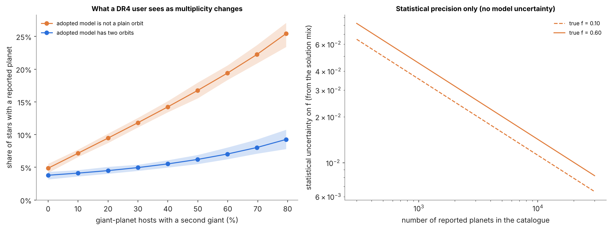
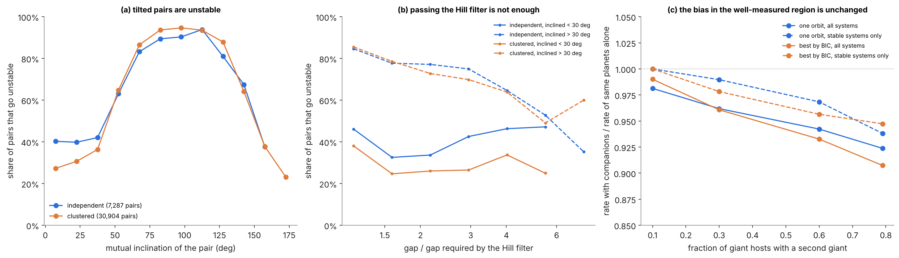
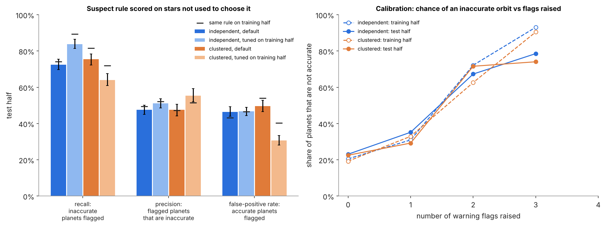
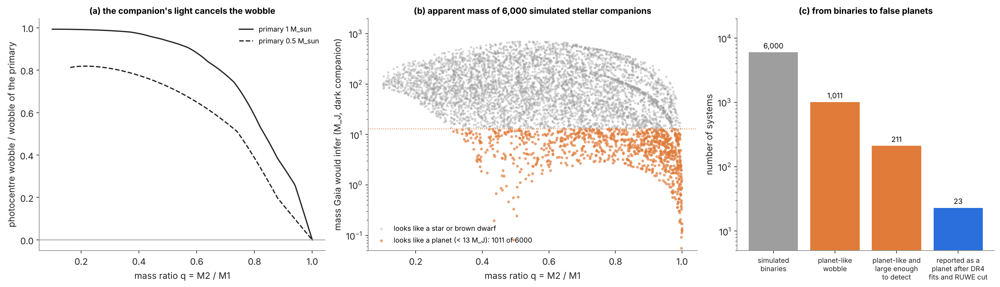
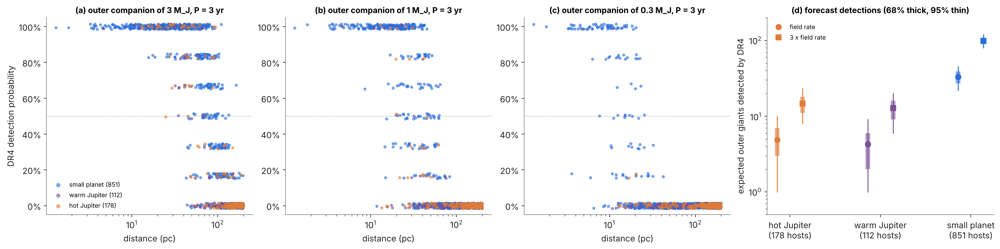
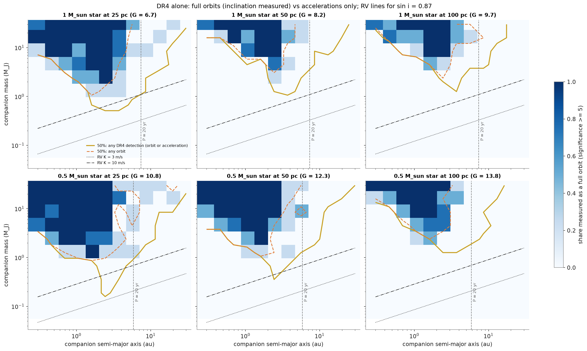
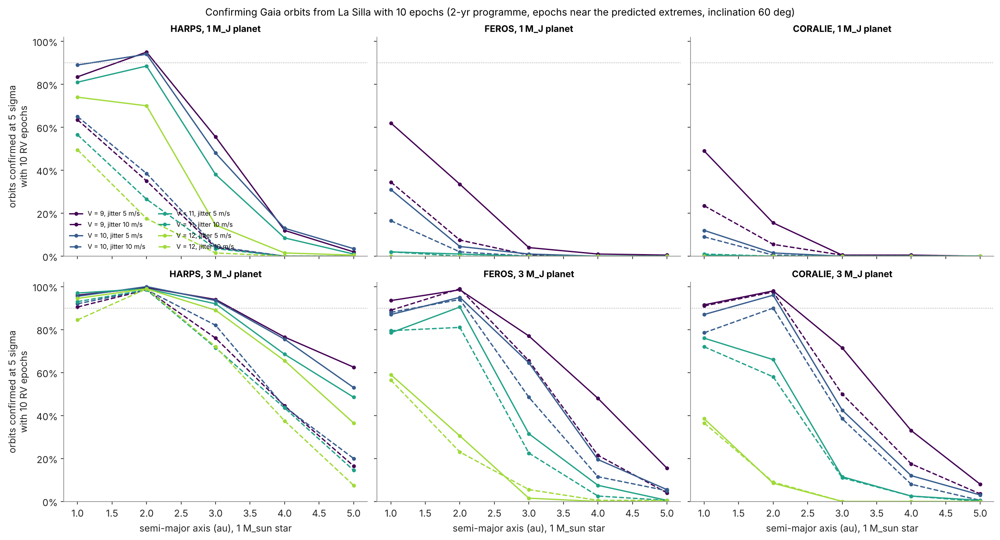

# Gaia DR4 and multi-planet systems: questions, methods and results

## About this document

This document describes the science questions behind this code, the method used to answer each of them, every important assumption and number, where each number came from, and the results. It is organised around the main questions. Where a value or rule was taken from Lammers & Winn, the section or equation number is given. The paper is cited as **L&W**: C. Lammers and J. N. Winn, "On the Exoplanet Yield of Gaia Astrometry", The Astronomical Journal 171:18 (2026), arXiv:2511.04673.

## The science questions and the short answers

### Background

Gaia measures the position of each star many times over several years. Each measurement is one-dimensional: the position along the direction Gaia is scanning at that moment (the along-scan direction). A star moves on the sky because of its own motion (proper motion), because of Earth's orbit (parallax), and, if it has planets, because of a small orbital wobble around the system's centre of mass. Gaia Data Release 4 (DR4, expected December 2026) contains about 5.4 years of data and, for the first time, the individual measurements (epoch astrometry) of all stars.

L&W is the reference forecast of the DR4 planet yield (7,500 ± 2,100 planets). Their simulations assign at most one planet per star (L&W Section 4.2), and in Section 6.2 they state that they have not investigated systems with more than one planet, how hard such systems are to distinguish from single-planet systems, or how accurately the parameters can then be recovered. Real systems often have more than one giant planet. This project fills that gap.

### The six questions

- **Q1. Detection.** Does a second, unmodelled planet make a Gaia-detectable planet harder (or easier) to detect?
- **Q2. Accuracy and warnings.** Does it make the fitted orbit wrong (period, mass, eccentricity), and would Gaia's own quality indicators warn the user?
- **Q3. DR4's alternative models.** DR4 publishes, besides the one-companion orbit, an orbit plus acceleration, an orbit plus jerk and a two-companion orbit. Does fitting these models, and choosing between them, solve the problem?
- **Q4. Occurrence rates and yield.** How much does multiplicity bias the giant-planet occurrence rate that will be inferred from DR4, how does that depend on how common multi-giant systems are, and how does it change the number of planets DR4 will report?
- **Q5. RUWE.** Can multiple planets push a star's RUWE above 1.4, so that the common practice of removing RUWE > 1.4 stars removes planet hosts?
- **Q6. Follow-up.** Which DR4 planets should be distrusted, using only what DR4 publishes, and how efficiently can radial-velocity observations confirm them or reveal a hidden second giant?

### Short answers

- **Q1.** Yes. For a planet that Gaia detects 80% of the time on its own, an unmodelled companion lowers detection to 69% when fitted with one orbit (step 2). Companions with periods similar to the DR4 time span (3.8 to 11 yr) are the most harmful: the planet is then found correctly only 24% of the time.
- **Q2.** Yes. 19% of the planets reported by a one-orbit fit are wrong (neither planet's true orbit). 99% of these pass Gaia's DR3 goodness-of-fit cut (F2 < 25). DR4's own label for weak orbits (OrbitalPoorlyConstrained, significance < 5) would flag only 55 to 60% of them; the rest would be published as normal orbits.
- **Q3.** Largely. Choosing among DR4's models by the Bayesian information criterion raises correct recovery of the planet from 52% to 69% of systems with a companion. The two-companion model helps most for companions with periods under about 11 years; acceleration and jerk models help most for slower companions with a larger wobble. False alarms stay near 1%.
- **Q4.** It depends on how often giant-planet hosts have a second giant (f). With the same true occurrence rate at every f: in the part of parameter space Gaia measures well (3 to 13 M_J, 1 to 8 yr), the bias is small (0 to −8%). For the occurrence rate over the whole giant-planet range (0.3 to 13 M_J, 0.1 to 8 yr), obtained by fitting a power law, a one-orbit analysis underestimates the rate by 2% at f = 10%, by 28% at f = 60% (close to the multiplicity measured by Bryan et al. 2016) and by 42% at f = 80%. Using DR4's model choice reduces these to +1%, −8% and −13%. At a fixed true occurrence rate, higher multiplicity lowers the DR4 yield: from about 12,700 to 9,600 reported planets (one-orbit fits) or 10,300 to 8,100 (model choice) between f = 10% and 60%, for stars within 250 pc with RUWE ≤ 1.4, scaled to the whole sky.
- **Q5.** Almost never. Planets alone push RUWE above 1.4 for only 0.5% of stars with one giant and 0.9% of stars with several. The 14% of nearby stars with RUWE > 1.4 are therefore overwhelmingly stellar or brown-dwarf binaries, and the RUWE cut removes fewer than 1% of planet hosts.
- **Q6.** Four flags visible in DR4 (an adopted model other than a plain orbit, significance below 5, period above 0.7 of the time span, eccentricity above 0.5) together mark 55 to 62% of DR4-like planets as suspect and catch 73 to 79% of the inaccurate planets and 97 to 98% of the spurious ones; a planet without any flag is inaccurate in only about 22% of cases (against 47 to 49% with a flag). Radial velocities confirm almost every Gaia orbit cheaply (95% with 10 HARPS epochs or fewer), but most DR4 hosts are faint (median V ≈ 13.5): for suspect planets on stars with V ≤ 12 (about 1,400 to 1,900 over the whole sky), a hidden giant is found with 20 HARPS epochs or fewer over 3 years in 69 to 89% of cases.

## Papers and data used

- **L&W 2026** (above): detection rule, eccentricity distribution, occurrence model, star selection, noise level, and the yields we compare with.
- **K. El-Badry et al. 2024, Gaiamock** (github.com/kareemelbadry/gaiamock): Gaia scanning law, measurement times and noise model. L&W used it for all their simulations (L&W Section 3), and so do we.
- **B. Holl et al. 2023a** (arXiv:2206.05439): per-CCD noise curve used by Gaiamock.
- **J.-L. Halbwachs et al. 2023**: Gaia DR3 astrometric binary pipeline; Thiele-Innes conversions and the F2 statistic.
- **Gaia DR4 draft data model** (pre-release, June 2026): DR4 table contents and orbit solution types.
- **Gaia DR4 pre-release epoch astrometry** (12 sources, June 2026): used to check our noise model and fitter on real data.
- **Gaia DR3 source catalogue** (via the ESA Gaia archive and CDS VizieR, catalogue I/355/gaiadr3): the real stars of step 3.
- **D. M. Kipping 2013**: eccentricity distribution Beta(0.867, 3.03) (as L&W Section 4.2).
- **B. Gladman 1993**: two-planet stability rule (as L&W Section 6.2).
- **B. J. Fulton et al. 2021 / California Legacy Survey (CLS)**: giant-planet occurrence, through L&W's Eq. 23.
- **M. L. Bryan et al. 2016**: fraction of giant-planet hosts with an outer giant companion.

## How the simulated Gaia data are made

### Conventions

All conventions are the same as Gaiamock's, so that our simulated data can be fitted with Gaiamock's code and vice versa. Times are years from the DR4 reference epoch (J2017.5, JD 2457936.875); periods and times of periastron are in days; positions in milliarcseconds (mas); planet masses in Jupiter masses (M_J), star masses in solar masses.

### Observations

- Times, scan angles and parallax factors of each observation come from Gaiamock's scanning law for the star's sky position. DR4 covers JD 2456891.5 to 2458868.5 (5.41 years, called T below). A "transit" is one passage of the star through Gaia's field of view.
- As in Gaiamock and L&W, 10% of transits are removed at random. Typical number of transits per star: median 79 (range about 40 to 200).

### The star's motion

- Without planets the along-scan position is Λ = α_off sin ψ + δ_off cos ψ + μ_α* t sin ψ + μ_δ t cos ψ + ϖ f_ϖ (position offsets, proper motions, parallax and the along-scan parallax factor).
- Each planet adds a Keplerian reflex orbit of angular size a0 = a × m/(M_central + m) × ϖ, where a follows from Kepler's third law. Several planets are added together, with nested (Jacobi) masses; planet-planet interactions are ignored, which is a good approximation over 5.4 years except near resonances.
- The orbit is projected on the sky with Thiele-Innes constants (A, B, F, G), in Gaiamock's convention.

### Noise

- Per-CCD uncertainty as a function of G magnitude from the Gaiamock table (Holl et al. 2023a, Fig. 3). Per-transit uncertainty σ_fov = σ_CCD/√8, assuming independent CCD errors within a transit (L&W footnote 5). For bright stars this is about 0.045 to 0.053 mas.
- For G < 13 an extra random noise of size U(0, 0.04) mas is added and not reported to the fitter, as in Gaiamock.
- **Checked on real DR4 data** (see "DR4 pre-release check"): the formal per-CCD errors agree with the table to 5 to 10% at G = 14 to 20, and the CCD errors within a transit are uncorrelated (correlation −0.001 ± 0.007), so σ_fov = σ_CCD/√8 holds.

## How the data are fitted

### Models

All models are fitted to the along-scan data. For fixed period P, eccentricity e and phase, the remaining parameters enter linearly and are solved exactly by least squares (the method of the Gaia DR3 pipeline and of L&W); the nonlinear search is over P, e and phase only.

- **No planet (5 parameters):** positions, proper motions, parallax.
- **One planet (12):** adds P, e, phase and the four Thiele-Innes constants. DR4 name: Orbital.
- **One planet + acceleration (14):** adds two terms quadratic in time (a slowly curving path from a companion much slower than the data span). DR4: OrbitalAlternativeAcceleration.
- **One planet + jerk (16):** adds two further cubic terms. DR4: OrbitalAlternativeJerk.
- **Two planets (19):** two orbits fitted together. The second orbit is found by searching what is left after fitting the first (a periodogram of the residuals), followed by a joint fit. DR4: OrbitalAlternativeMultiple.
- **Acceleration only (7) and jerk only (9):** no orbit, only the curved path.

### Search method

- One planet: Gaiamock's optimiser (periodogram multistart), P from 10 to 10,000 days, e from 0 to 0.99.
- Models with acceleration, jerk or two planets: our own numpy optimiser (circular-orbit periodogram over all trial periods, followed by Nelder-Mead from the best minima). On the same one-planet problem it reaches Gaiamock's χ² or a lower value in 96% of systems, and the detection decisions agree in 96%.
- Uncertainties: Jacobian at the best fit, inflated by Gaiamock's goodness-of-fit factor, as in Gaiamock.

### Detection rule (L&W Sections 4.2, 4.3)

- Δχ² > 50 between the planet model and the matching no-planet model (for the acceleration and jerk models, the comparison is the acceleration-only or jerk-only model, so a star that only accelerates is never counted as a planet).
- Fitted mass below 13 M_J.
- Period constrained: (P + σ_P)/(P − σ_P) < 1.5, our linearised version of L&W's P84/P16 < 1.5, checked against Gaiamock's MCMC (see Step 1 results).
- **Two planets "if justified":** the second planet is reported only if removing it raises χ² by more than 50 and it also passes the mass and period rules.

### Choosing between models: BIC

- BIC = χ² + k ln N, where k is the number of parameters and N the number of transits. A more complex model must lower χ² by more than ln N ≈ 4.4 per extra parameter.
- The "best model by BIC" analysis computes the BIC of all seven models (no planet, acceleration only, jerk only, one planet, + acceleration, + jerk, two planets) and adopts the lowest, then applies the detection rule.
- **This is our assumption of how DR4 chooses.** The DR4 data model lists one adopted solution type per source in each orbit table and does not give the selection rules, which will be in the DR4 documentation.

### Quality indicators

- **F2:** the DR3 goodness-of-fit statistic of an orbit (DR3 rejected F2 > 25). It is computed on per-CCD data, so a model error is diluted about 8 times relative to transit-level data.
- **Significance:** a0/σ_a0. DR4 labels an orbit with significance below 5 as OrbitalPoorlyConstrained.
- **RUWE** (renormalised unit weight error): computed from the χ² of the 5-parameter fit, converted to per-CCD data as for F2: RUWE = √((7N + χ²)/(8N − 5)). A single star has RUWE ≈ 1.

## Tests

The code has 45 automated tests. Highlights:

- Kepler solver, Kepler's law (Jupiter and the Sun), mass inversion, Thiele-Innes conversions, superposition of two planets, stability rule (reproduces L&W's Section 6.2 example).
- A noise-free planet is fitted exactly (χ² below 1e-12); with noise only, χ² averages N − 5.
- Orbit + acceleration and two-planet fits recover planted signals; the two-planet fit gives a small gain for a single planet.
- BIC model choice, step 2 outcome rules, RUWE (equals 1 for pure noise), significance (matches a Monte Carlo).
- Occurrence model (CLS normalisation), multiplicity scenarios (Bryan calibration, same mean rate, stability), Gaia star selection cuts, L&W's distance limit, download query formats.
- Rate estimators: recovery of a known power law; and a toy survey with noisy fitted masses and periods, which shows that counting detections at fitted values with a completeness measured at true values is biased by more than 15% in some bins, while the corrected estimators recover the truth (within 3% in total).
- Multiplicity reweighting reproduces the requested fraction of multi-giant hosts.
- Gaiamock-based tests (run only where Gaiamock is installed): our simulated wobble equals Gaiamock's to 1e-9 mas; our χ² and F2 equal Gaiamock's to 1e-12; our optimiser and σ_P match Gaiamock's; RUWE and σ_a0 agree with Gaiamock's.
- Real-data tests on the DR4 pre-release: file reader, single-star parallax, independence of CCDs within a transit, and recovery of three published orbits.

## Step 1: single planets, compared with L&W

### Setup

10,000 single planets with SNR1 (wobble ÷ per-transit noise) log-uniform from 0.1 to 5 and period log-uniform from 50 days to 3T; G uniform 8 to 15; star mass 0.4 to 1.3 M_sun; parallax 2 to 100 mas; random orientations.

### Results

- **Δχ² against SNR1:** Δχ² ≈ 21 to 24 × SNR1², matching L&W Eq. 31 for DR4 (≈ 22 SNR1²). Our χ² equals Gaiamock's to 1e-13.
- **Threshold:** detection is 50% at SNR1 = 1.79, consistent with L&W's "Δχ² > 50 corresponds to SNR1 ≳ 1.5" once noise scatter is included.
- **Longest periods:** detection (for SNR1 > 3) falls below 50% at P/T = 0.93, about 5.0 years.
- **Period-error limit (L&W's definition):** L&W define the DR4 period limit (4.0 yr) as the period where the mean relative period error of recovered orbits reaches 20% (L&W Section 3.1, Fig. 10). Our value, for planets with SNR1 > 3: the mean period error reaches 20% at P/T = 0.80, i.e. 4.3 years (the median error reaches 20% at 5.9 years). This agrees with L&W's 4.0 years to within 8%. L&W's 4.0-yr limit and our detection limit (5.0 yr) measure different things: planets with periods of 4 to 5 years are often still detected, but with poorly measured periods.
- **Mass bias near threshold:** detected masses are biased high near the detection limit (median +11%, 84th percentile +65%), because a weak planet is detected mostly when noise makes its signal look larger. This is the Eddington bias, which also appears in steps 2 and 3.
- **Period rule check:** on 15 systems near the data-span limit, Gaiamock's MCMC gave the same period widths as our linearised rule (median ratio 1.00); our rule is if anything slightly stricter.

## Step 2: one hidden companion (Q1 to Q3)

### Design

- 20,000 simulated two-planet systems. The **target** planet is detectable on its own: SNR1 log-uniform 1.5 to 10, period 100 days to 0.7T (3.8 yr), mass 0.3 to 13 M_J, Kipping eccentricity. The **companion** has a period log-uniform from 30 days to 10T (54 yr), inside or outside the target, and a wobble ratio (companion's wobble ÷ target's) log-uniform from 0.01 to 100; its mass, which must be 0.3 to 13 M_J, follows from these. Orientations are random and independent. Every pair must be Hill stable (separation > 2√3 mutual Hill radii at closest approach; Gladman 1993).
- Stars: G 8 to 15, 0.4 to 1.3 M_sun, parallax 2 to 100 mas, random sky positions (so realistic numbers of transits).
- **Paired design:** each system is analysed twice with identical observation times and noise, once with the target alone and once with both planets. Any difference is caused by the companion; the near-threshold mass bias cancels.
- Analyses: one planet, + acceleration, + jerk, two planets, and best model by BIC.
- **Outcomes:** target correct (period within 10% and mass within 20% of the target-alone result, or of the truth if that was not detected), companion correct, wrong (a reported planet matching neither), acceleration or jerk only, nothing.
- These percentages describe kinds of companions spread evenly in log period and log wobble ratio, not a real population; the population weighting is step 3.

### Results for Q1 (detection)

- One-planet fit: the target is detected in 80.2% of systems when alone and 68.6% with the companion (3,002 detections lost, 670 gained).
- Weak companions (wobble less than about a third of the target's) and slow companions with a smaller wobble are harmless (target correct 80% and 72%, the same as without the companion).
- Companions with a period below 3.8 yr and a strong wobble: target correct 28%.
- Companions with periods of 3.8 to 11 yr (similar to the data span): target correct 24%, the worst case.
- Companions slower than 11 yr with a larger wobble: target correct 46%.
- Besides the companion's period and wobble, what matters most is the target's own signal strength, then the number of transits and the target's eccentricity; the companion's orientation hardly matters.

### Results for Q2 (wrong orbits and warnings)

- Of the planets reported by the one-planet fit with a companion present: target correct 75.6%, companion correct 5.8%, wrong 18.7%.
- 98.9% of the wrong planets pass the DR3 cut F2 < 25. The reason is that F2 is computed on per-CCD data, where a model error is diluted about 8 times.
- DR4's significance label: of the systems with a wrong planet, 46% (one-planet fit) and 41% (best model by BIC) would be published as normal orbits (significance ≥ 5); the rest would be labelled OrbitalPoorlyConstrained.

### Results for Q3 (DR4's alternative models)

Percentage of all 20,000 systems in mutually exclusive categories (each system counted once, so each row adds up to 100%): both planets correct / target only / companion only (target missed) / a correct planet plus a wrong one / wrong planet only / acceleration or jerk only / nothing reported, with the false-alarm rate on the target-alone data in brackets. A planet of some kind is reported in the first five categories together (68.6% for one planet, 78.9% for the BIC choice).

| Analysis | Both | Target only | Companion only | Correct + wrong | Wrong only | Acc./jerk only | Nothing | [False alarm] |
|---|---|---|---|---|---|---|---|---|
| One planet | 0.0 | 51.8 | 4.0 | 0.0 | 12.8 | 0.0 | 31.4 | [0.8] |
| One planet + acceleration | 0.0 | 61.7 | 3.2 | 0.0 | 10.0 | 0.0 | 25.1 | [0.9] |
| One planet + jerk | 0.0 | 63.5 | 2.6 | 0.0 | 8.9 | 0.0 | 24.9 | [0.8] |
| Two planets (if justified) | 5.2 | 55.3 | 1.2 | 4.4 | 11.0 | 0.0 | 23.0 | [1.0] |
| Best model by BIC | 5.1 | 61.4 | 1.2 | 2.8 | 8.3 | 0.6 | 20.6 | [1.0] |

"Target correct" in the text below counts every system where the target is found, whether or not a second planet is also reported (for the BIC choice 5.1 + 61.4 + part of 2.8 = 68.6%). Version 0.1.0 of this document listed target correct, companion correct and wrong planet as overlapping shares, so the two-orbit and BIC rows added up to more than 100%. The table is made by scripts/extended/g2_step2_exclusive.py.

By kind of companion, target correct with one planet → best model by BIC:

- Period < 3.8 yr, weak wobble: 80% → 79%.
- Period < 3.8 yr, strong wobble: 28% → 53% (the two-planet model chosen in 75% of these; both planets found correctly in 28%).
- Period 3.8 to 11 yr: 24% → 63%.
- Period > 11 yr, smaller wobble: 72% → 73%.
- Period > 11 yr, larger wobble: 46% → 68% (acceleration or jerk models chosen in 56%).

The BIC choice adopts a model other than one planet in 53% of systems with a companion and 10% of systems without one. Both planets are found correctly in 5% of all systems (28% for strong short-period companions). A known limitation: the sequential two-planet search can lock onto a blended first orbit when the two planets have similar wobbles near a 2:1 period ratio.

### Posterior examples

For three example systems (no planet; a 3 M_J planet at 1.5 yr; the same plus a 1.9 M_J companion at 15 yr) the posterior distributions were sampled with an ensemble MCMC sampler (Goodman and Weare stretch moves; the linear parameters are marginalised analytically; 32 walkers × 2,500 steps for one-orbit models, 64 walkers × 20,000 steps for the two-planet model) and shown as corner plots (command: python scripts/step2.py examples). With the companion present, the one-planet model gives a mass spread over 5 to 20 M_J, tied to eccentricities near 1; the acceleration model recovers about 3 M_J and is the one BIC adopts; the two-planet model places the second orbit at about 27 years with about 200 M_J, because a companion much slower than the time span only shows as curvature. Without a planet, the one-planet model finds only noise solutions (Δχ² = 24) and BIC adopts no planet.

## Step 3: real Gaia stars, occurrence rates and yield (Q4, Q5)

### Stars

- Gaia DR3 sources with parallax > 4 mas (closer than 250 pc) and parallax/error > 10, in 365 randomly placed, non-overlapping circles of 3° radius covering 25.0% of the sky (centres on an even 768-point grid on the sphere, taken in a fixed random order). Nearby stars are distributed the same way in all directions, so a random fraction of the sky is a fair sample; all rates are per star. 921,126 sources.
- Selection (L&W Section 4.1): main sequence, 0.4 < M_G − 2.9 (BP − RP) < 4.5 (L&W Eq. 38): 811,021; closer than L&W's distance limit r_max(M_G) (Eqs. 36, 37) and 250 pc: 756,604; M_G ≤ 12 (mass relation valid, M > 0.2 M_sun): 675,548; RUWE ≤ 1.4: 578,498 (97,050, 14%, removed).
- 300,000 of these, chosen at random, are used. Star masses from M_G with the main-sequence mass-magnitude relation (as L&W).

### Planets

- Occurrence model: L&W Eq. 23 (CLS-normalised Fulton et al. 2021 shape), 0.3 to 13 M_J and 0.1 to 30 au, scaled with stellar mass; Kipping eccentricities; random, independent orientations. On these stars this gives 0.20 giants per star over the full range and 0.102 per star in the window 0.3 to 13 M_J, 0.1 to 8 yr.
- **Two multiplicity scenarios with the same mean number of giants per star:**
- Independent: each star gets a random (Poisson) number of giants, independently. 12% of giant hosts have two or more giants.
- Clustered: only a fraction of stars can host giants, and those host more. Calibrated so that a giant host has an outer giant companion (1 to 13 M_J, 5 to 20 au) with the probability measured by Bryan et al. (2016), scaled to our mass range. 59% of giant hosts then have two or more giants.
- Every multi-planet system must be Hill stable; an unstable planet is redrawn and, if that fails, dropped.

### Design

- **A:** every star with all its planets (what Gaia sees).
- **B:** each planet alone on its star, with the same observations and noise (the reference with no multiplicity). A − B isolates the effect of planets sharing a star.
- **I:** 15,000 single injected planets (log-uniform in mass and in period from 0.05 to 16 yr, hosts chosen in proportion to stellar mass), used to measure the completeness as a DR4 user would.
- **V:** 400 systems per scenario just below the pre-fit cut (summed SNR1 0.5 to 0.8), to confirm that systems below the cut are not detectable: 0 of 400 were.
- **N:** 1,500 stars without planets, for the RUWE of single stars.
- Each A, B, V and I system is fitted with all four DR4 orbit models, and the best model by BIC is derived from those fits. The DR4 RUWE (and a DR3 RUWE, from DR3 observation times) is computed for every star.

### How occurrence rates are inferred

- Bins: mass 0.3, 1, 3, 13 M_J; period 0.1, 0.3, 1, 2, 4, 8 yr. Rate in a bin = detections ÷ (number of stars × completeness).
- **Bin migration.** Near the detection limit the fitted mass and period scatter away from the true values, and detected planets are mostly those whose signal fluctuated up (Eddington bias), so planets migrate between bins. The completeness is therefore measured with the injected planets counted at their fitted parameters (detected in fitted bin ÷ injected in true bin). Only bins with completeness ≥ 5% are used (3 to 13 M_J at 1 to 2, 2 to 4 and 4 to 8 yr).
- **Power law** over the whole window (0.3 to 13 M_J, 0.1 to 8 yr), Γ = C m^α P^β per ln m per ln P, fitted by forward modelling: the expected detections in each fitted cell are predicted through the injection response matrix (true cell → fitted cell, with true cells extending from 0.05 to 16 yr), and compared with the detections by a Poisson likelihood. The rate is Γ integrated over the window.
- **Closure test:** with each planet alone (B), these methods recover the true rate: power law within 1 to 3% (one planet) and within 3 to 8% (best by BIC), well-measured bins within about 3%.
- Reported planets are also classified as **correct** (period within 10%, mass within 20% of a real planet), **imprecise** (a real planet measured loosely: period within a factor 1.5, mass within a factor 2) or **spurious** (no real planet resembles it).

### Results: the two scenarios

- **Independent multiplicity:** no measurable effect. Well-measured bins, one-planet fit: A +0.9%, B +2.9% relative to the truth (A vs B −1.9%). Power law: A 0.0997, B 0.1013, truth 0.1021 planets per star.
- **Clustered multiplicity:** well-measured bins, one planet: A −10.4%, B −2.3% (A vs B −8.4%); best by BIC: A −9.0%, B −1.8% (A vs B −7.3%). Power law, one planet: A 0.069 against a truth of 0.096 (−29%), B 0.099 (+3%); best by BIC: A 0.083 (−14%), B 0.104 (+8%).
- The deficit is concentrated at short periods and lower masses (for example 3 to 13 M_J at 0.3 to 1 yr), where the completeness is low: the companion of an inner giant is usually an outer giant with a larger wobble, which spoils the fit of the inner one. The power law, which relies on these detections for its shape, carries the deficit over to the whole giant-planet range.
- **Accuracy of reported planets** (one planet, independent): correct 53%, imprecise 33%, spurious 14%; best by BIC: 63%, 33%, 4%. The split is the same in A and B, so most inaccurate planets come from being near the detection threshold, not from multiplicity. With clustered multiplicity, A finds 9 to 11% fewer real planets than B.

### Results: multiplicity scan (Q4)

- **Method (no new fits).** Each star's result depends only on its own planets, so a population with any fraction f of giant hosts having two or more giants can be assembled by reweighting the fitted host stars of both scenarios. The number of giants per host follows a zero-truncated Poisson distribution whose parameter sets f. The weights are applied separately in four bins of stellar mass, and the fraction of stars hosting giants is set so that the number of giants per star in the window (0.3 to 13 M_J, 0.1 to 8 yr) equals the CLS-calibrated value (0.102 per star) in every stellar-mass bin. Every f therefore has the same true occurrence rate. Uncertainties are bootstrap 16 to 84% ranges of this simulation (resampling hosts and injections), not DR4 statistics. At f ≥ 0.5 a small tail of very crowded systems (1 to 14%) is not represented in the simulated hosts; the scan reports the f actually reached.
- **Occurrence rate over the whole window** (power law), inferred ÷ true, at f = 0 / 10 / 30 / 60 / 79%:
- One planet: 1.01 / 0.98 / 0.89 / 0.72 / 0.58 (B, planets alone: 1.01 to 1.03).
- Best by BIC: 1.03 / 1.01 / 0.97 / 0.92 / 0.87 (B: 1.03 to 1.11).
- **Well-measured bins** (3 to 13 M_J, 1 to 8 yr): one planet 1.08 / 1.05 / 1.01 / 0.98 / 0.97 (B 1.08 to 1.04); best by BIC 1.02 / 1.00 / 0.98 / 0.97 / 0.98 (B 1.02 to 1.09). The effect of multiplicity here is 0 to −8%.
- **Yield** (planets reported, stars within 250 pc with RUWE ≤ 1.4, scaled to the whole sky: 578,498 selected stars ÷ 0.25 = 2.31 million stars), at f = 0 / 10 / 30 / 60 / 79%:
- One planet: 13,300 / 12,700 / 11,400 / 9,600 / 8,200; of which real planets (correct + imprecise) 11,400 / 10,900 / 9,900 / 8,300 / 7,100.
- Best by BIC: 10,700 / 10,300 / 9,400 / 8,100 / 7,200; real planets 10,300 / 9,900 / 9,100 / 7,800 / 6,800.
- At a fixed true occurrence rate, more multiplicity means fewer detections: the same planets sit on fewer stars, and each one is harder to fit.

### Comparison with L&W's yield

- L&W predict 7,500 ± 2,100 DR4 planets (all distances). Our numbers differ because the assumptions differ: (1) L&W's yield counts a planet when SNR1 > 1.5 and P < 4 yr (their semi-analytic model), while we count detections from full orbit fits, which include periods of 4 to 8 yr (about 40% of our detections) and imprecise and spurious planets; (2) we use real Gaia stars within 250 pc, while L&W use a Galaxy model built from the luminosity function of stars within 100 pc; (3) we use Gaiamock's noise table, while L&W's yield uses the simplified σ_fov = 54 μas × max[1, 10^(0.2(G − 14))].
- Applying L&W's counting rule (SNR1 > 1.5, P < 4 yr) to our stars and planets gives about 11,100 (independent) and 7,900 (clustered) for the whole sky within 250 pc.
- Using in addition L&W's simplified noise level (54 µas per transit for G < 14) instead of the Gaiamock table (median about 46 µas per transit at G = 8–14 for our stars) lowers these to about 9,600 (independent) and 6,700 (clustered).
- Breakdown (independent scenario): full fits about 12,700 → L&W counting rule about 11,100 → L&W noise level about 9,600 → L&W 7,500 ± 2,100. The remaining difference (about 28%, within L&W's quoted uncertainty) comes from the stellar sample: real Gaia DR3 stars here, a Galaxy model built from the luminosity function within 100 pc in L&W.
- The 250 pc limit does not explain the higher yield: it removes stars that L&W include. Detections come from all distances (whole sky, independent, L&W rule): 0–50 pc about 900, 50–100 pc 2,600, 100–150 pc 3,300, 150–200 pc 2,700, 200–250 pc 1,600.

### Results: RUWE (Q5)

- Stars without planets: RUWE > 1.4 in 0.00% (1,500 stars).
- Independent scenario: RUWE > 1.4 for 0.47% of stars with one giant and 0.81% of stars with two or more (DR3 RUWE: 0.15% and 0.24%).
- Clustered scenario: 0.51% and 0.91%.
- RUWE > 1.4 is reached mainly by strong, short-period signals; long-period planets are partly absorbed into the proper motion.
- Conclusion: removing stars with RUWE > 1.4 removes fewer than 1% of planet hosts, and multi-planet systems are not preferentially removed. Stellar and brown-dwarf companions, which cause most of the observed RUWE > 1.4 cases, are not simulated.

## Step 4: warning signs and radial-velocity follow-up (Q6)

### Design (scripts/step4.py)

- Uses only the step 3 results (the fits of the real-star sample); no new Gaia fits. It runs in about 10 seconds.
- Planets analysed: every planet reported for the real systems (A) by the best model by BIC (what DR4 would publish) and, for comparison, by the one-planet fit, in both multiplicity scenarios.
- **Flags** use only quantities a DR4 user can see: the adopted model (other than a plain orbit), significance below 5 (OrbitalPoorlyConstrained), period above 0.7 T (3.8 yr), eccentricity of the one-planet fit above 0.5, Δχ² below 100 (near threshold), period error above 10%, RUWE above 1.2. A planet is **suspect** if any of the first four flags is set.
- For each flag: share of planets flagged; share inaccurate (imprecise or spurious), spurious, and with a hidden giant (another giant of 0.3 to 13 M_J at 0.1 to 30 au on the star that was not reported), among flagged and unflagged planets; and the share of all inaccurate, spurious and hidden-giant cases that the flag catches.
- **Radial velocities** (src/gaiabias/rv.py; all numbers are simple, documented assumptions):
- Semi-amplitude K = 28.43 m/s × m sin i/M_J × (P/yr)^(−1/3) × (M*/M_sun)^(−2/3)/√(1 − e²), using the true inclinations.
- V magnitude from G and BP − RP (Gaia DR3 relation of Riello et al. 2021), with BP − RP from M_G along the main-sequence locus used in the selection.
- Precision per epoch: HARPS 1.0 m/s at V = 8 in 900 s (floor 0.5 m/s); FEROS 5.0 m/s at V = 8 in 1200 s (floor 4 m/s); photon noise scaling as 10^(0.2(V − 8)); stellar jitter 2 m/s (M* > 0.6 M_sun) or 3 m/s (M dwarfs); 300 s overhead per epoch. Practical faint limits V ≤ 12 (HARPS) and V ≤ 10 (FEROS).
- Epochs for a 5σ result: to confirm a Gaia orbit (period known) N = 2(5σ/K)²; to reject a spurious orbit, the same with the difference between predicted and true signals; to detect a hidden giant over a 3-year programme, as an orbit (N = 2(5σ/K)², at least 8) when its period is shorter than the programme, otherwise as a trend (N = 12(5σ/Δv)², with Δv the typical velocity change over the programme). At least 6 epochs always.

### Results: warning flags

Best model by BIC, independent / clustered multiplicity. Reported planets: 1,302 / 898 in the sample (10,000 / 6,900 over the whole sky); inaccurate 37% / 37%; spurious 4% / 4%; star hides another giant 25% / 79%.

- **Significance < 5:** 19% / 17% of planets; inaccurate 76% / 85% of flagged against 28% of unflagged; catches 62% / 73% of spurious planets.
- **Eccentricity > 0.5:** 25% / 27%; inaccurate 65% / 63% against 27% / 28%; catches 74% / 70% of spurious planets.
- **Near threshold (Δχ² < 100):** 29% / 28%; inaccurate 59% / 57% against 27% / 30%.
- **Adopted model not a plain orbit:** 8% / 20%; hardly more often inaccurate (42% / 40% against 36% / 37%) but much more often hiding another giant (61% / 93% against 21% / 75%). For the one-planet analysis the same flag (the BIC preferring another model) catches 81% of spurious planets.
- **Period > 3.8 yr:** 29%; inaccurate 42% / 44% against 34% / 35%. **Period error > 10%:** 8% / 10%; inaccurate 52% / 60%.
- **RUWE > 1.2** marks the more accurate planets (inaccurate 19% / 23% against 44%), because a high RUWE means a strong signal. It is not a warning sign.
- **Suspect (any of the first four):** 55% / 62% of planets; inaccurate 49% / 47% against 22% / 21%; catches 73% / 79% of inaccurate, 98% / 97% of spurious and 72% / 64% of hidden-giant cases.

### Results: radial-velocity follow-up

- DR4 planet hosts are mostly faint K and M dwarfs: median V = 13.3 (independent) and 13.8 (clustered). Median HARPS precision 12 to 15 m/s per epoch, FEROS 58 to 76 m/s.
- **Confirming the Gaia orbit** is cheap because Gaia planets are massive: 95% with 10 HARPS epochs or fewer (median 6); 47 to 58% with FEROS. A spurious orbit is rejected with 10 HARPS epochs or fewer in 94 to 95% of cases.
- **Finding the hidden giant** over a 3-year programme with 10 / 20 / 40 HARPS epochs: 40 / 47 / 52% (independent) and 56 / 60 / 65% (clustered) of stars with a hidden giant; with FEROS 17 / 23 / 27% and 33 / 39 / 44%. The others are too slow or too light to show up in 3 years.
- **Within practical reach** (suspect planets on stars with V ≤ 12, HARPS): about 1,900 (independent) or 1,400 (clustered) planets over the whole sky, needing about 6,500 or 4,800 hours of HARPS time in total (at most 40 epochs each); among them, a hidden giant is found with 20 epochs or fewer in 69% or 89% of cases. With FEROS (V ≤ 10): about 800 or 540 planets, 4,600 or 2,700 hours. Only the southern part of the sky is observable from La Silla, roughly halving these numbers for one site.

### Recipe for follow-up

- Distrust first the DR4 planets with significance below 5 or eccentricity above 0.5; these are most often imprecise or spurious, and a few RV epochs decide.
- Look for hidden giants first around stars where DR4 adopted an acceleration, jerk or two-companion model: in the clustered case 93% of them have another giant.
- Restrict precise RV follow-up to V ≤ 12 (HARPS) or V ≤ 10 (FEROS); plan 6 to 10 epochs to confirm the orbit and about 20 epochs over 3 years to look for a companion.

## Extended analyses (version 0.2.0)

Robustness tests and forecasts added in version 0.2.0. The scripts are in scripts/extended/ (see its README); results go to results/extended/.

### Noise model (scripts/extended/g2_noise_robustness.py)

The first 1,000 step 2 systems were refitted under four less favourable noise models, always using the reference uncertainties in the fit, as a DR4 user would: CCD measurements within a transit correlated with ρ = 0.05 (the DR4 pre-release gives ρ = −0.001 ± 0.007); an extra error shared by all transits within four days, at half the per-transit error; an unreported excess of 0.03 mas growing by 50% per magnitude fainter than G = 13; and all errors 30% larger than reported.

- The detections lost because of the companion are the same under all five models: 12.6 to 13.8 percentage points (13.4 for the reference model).
- The gain from DR4's alternative models is not: the BIC choice finds the target in 68.3% of systems against 51.5% for one orbit with the reference noise, but 50.7% against 42.9% when the errors are underestimated. Under each alternative the BIC choice reports a wrong planet more often than the one-orbit fit (14.7 to 18.0% against 12.1 to 13.7%). False alarms stay at or below 2.5%.
- Conclusion: the effect of a companion does not depend on the noise model; the reliability of acceleration and two-orbit solutions depends on how well the uncertainties are calibrated.

### Bayesian evidence versus the BIC (scripts/extended/g2_evidence.py, g2_evidence_truth.py)

For 197 step 2 systems (50 with a weak target, 50 with an eccentric planet, 47 near the 2:1 period ratio, 50 at random) the evidence of the seven models was computed: the linear parameters are integrated analytically with Gaussian priors and the period, phase and eccentricity of each orbit are sampled with nested sampling (dynesty). All ln Z errors are below 1.

- The two choices agree for 55% of systems (74% in the random group); 69% and 51% with priors three times narrower and wider. When the BIC adopts one orbit, the evidence agrees in 79 of 84 cases; when it adopts an orbit with a trend, the evidence prefers two orbits in 54 of 68.
- Against the true systems both do equally well overall (target correct 55% for the BIC, 52 to 54% for the evidence; a wrong planet in 18 to 19% for both). Where the BIC adopts two orbits and the evidence one, the evidence is better (target correct 56 to 88% against 31 to 38%, wrong planet 0 to 25% against 47 to 50%): the BIC adopts the two-orbit model too easily. The subsets contain 8 to 55 systems.

### Occurrence rate without a power law (scripts/extended/g1_rate_binned.py)

The step 3 inference was repeated with one free rate per mass-period cell and no assumed shape, using the injection response matrix.

- Only cells in which at least 5% of the injected planets are recovered can be measured, all at 3 to 13 M_J. There the rate for the real systems is 0.91 to 1.04 times the truth, and 0.94 to 0.99 times the rate for the same planets fitted alone.
- Cells holding 62 to 68% of the simulated giants, mostly below 3 M_J, have too little response for any rate to be measured without assuming a shape. The large full-range biases of the power-law fit come from extrapolating into these cells.

### Multiplicity from the mix of DR4 solutions (scripts/extended/g1_multiplicity_signal.py)

The share of stars with a reported planet whose adopted model is not a plain orbit rises from 5% when no host has a second giant to 25% when 79% do. Because this share is observable, it constrains multiplicity: with 3,000 reported planets to about ±0.02 to 0.03 (statistical only; the dependence on the noise model and the selection rule is not included).

### Dynamical stability (scripts/extended/g2_stability_nbody.py, g1_stable_scan.py)

All 38,191 neighbouring giant pairs of the step 3 population were integrated with rebound (WHFast, MEGNO) for 100,000 inner orbits. Unstable = close encounter within one mutual Hill radius, ejection or MEGNO > 4.

- 72% of pairs are unstable; 75% (independent) and 87% (clustered) of multi-giant systems contain an unstable pair. Instability depends mainly on mutual inclination: 30 to 40% below 30°, 86 to 89% above 60°. The Hill criterion used in the simulation is not sufficient for inclined pairs.
- Repeating the multiplicity scan with only the systems whose pairs all survive gives, in the well-measured region, 0.94 to 0.99 (one orbit) and 0.95 to 0.98 (BIC) times the rate of the same planets fitted alone, the same 1 to 6% effect as with all systems within the bootstrap ranges. The full-range power-law fit becomes unreliable for this subsample.

### Warning flags on held-out stars (scripts/extended/g1_flags_heldout.py)

The stars were split at random; thresholds were chosen on one half and scored on the other. The default rule (adopted model not a plain orbit, significance < 5, period > 0.7 T, eccentricity > 0.5) flags 72 to 75% of inaccurate planets, 48% of flagged planets are inaccurate and 47 to 50% of accurate planets are flagged. Tuned thresholds do not generalise better in both scenarios. The number of flags is a usable calibration: inaccurate in 23% of cases with no flag, 29 to 35% with one, 67 to 79% with two or three.

### Brown dwarfs and stellar binaries (scripts/extended/g2_mixed_flags.py, fig_binaries.py)

Brown dwarfs (13 to 80 M_J, 0.6% of stars) and stellar companions (mass ratio 0.1 to 1, Raghavan et al. 2010; 7.7% of stars at periods of 0.05 to 16 yr) were added to random step 3 stars. The photocentre orbit is the primary's reflex orbit scaled by (q/(1+q) − β)/(q/(1+q)), with β the companion's share of the G-band light from the main-sequence mass-magnitude relation, and is simulated as a dark companion with the same angular orbit. The same DR3 RUWE cut is applied.

- No brown dwarf is reported with a planetary mass. Of 6,000 stellar binaries, 1,011 have a planet-like photocentre orbit (apparent mass below 13 M_J), mostly near-twins; 211 of these are large enough to detect, and 23 are reported as planets after the DR4-like fits and the RUWE cut, with a median apparent mass of 8.8 M_J for companions of about 0.27 M_sun, all as plain orbits.
- At these rates binaries are 8 to 10% of reported planets. The flags catch 60 to 62% of them; recall falls by about 3 points, precision rises by about 5, and planets with no flag are inaccurate or not planets in 29 to 30% of cases instead of 23%. A DR4 planet sample therefore needs Gaia RVS velocities or one RV spectrum per target. These numbers rest on 23 simulated impostors and a simple binary population.

### Census of known planet hosts (scripts/extended/g2_census.py)

For every host of a planet with P < 200 d within 200 pc with a known distance, stellar mass and G magnitude (1,214 of 3,987 hosts in the NASA Exoplanet Archive composite table, queried 21 October 2026), outer companions of 0.3, 1, 3 and 10 M_J with periods of 0.5 to 12 yr were injected six times per grid point into simulated DR4 data with the host's own scanning pattern, and fitted with the one-orbit model. Hosts are classed by their inner planets.

| Inner-planet class | Hosts simulated | ≥ 50% detection at P = 3 yr (3 / 1 / 0.3 M_J) | Expected detections at the field rate (68%; 95%) | At 3 × field | Smallest ratio to field at 3σ | Expected 0.3–1 M_J |
|---|---|---|---|---|---|---|
| Hot Jupiters (P < 10 d) | 178 | 43 / 10 / 0 | 4.9 (3–7; 1–10) | 14.6 | 2.4 | 0.1 |
| Warm Jupiters (10–200 d) | 112 | 43 / 11 / 2 | 4.3 (2–6; 1–9) | 12.8 | 2.5 | 0.2 |
| Small planets | 851 | 497 / 262 / 87 | 33 (27–39; 22–45) | 99 | 1.5 | 2.6 |
| Other | 73 | 28 / 7 / 0 | 2.7 (1–4; 0–6) | 8.0 | 2.8 | 0.1 |

A 3 M_J companion with a 3-yr period is detected out to about 100 pc, 1 M_J to about 50 pc and 0.3 M_J to about 20 pc. Saturn-mass companions are expected around fewer than three hosts in any class.

### What DR4 alone measures (scripts/extended/g2_observability.py)

For a 1.0 and a 0.5 M_sun star at 25, 50 and 100 pc, companions of 0.19 to 30 M_J at 0.3 to 30 au were injected and classified as a full orbit (significance ≥ 5, inclination and node measured), a poorly constrained orbit, an acceleration only, or no detection. Full orbits need at least about 2.4 M_J at 1 to 2.4 au for a Sun-like star at 25 pc and 4.5 M_J or more at 50 to 100 pc; for the M dwarf, 1.3 to 2.4 M_J at 25 to 50 pc. Beyond about 5 au DR4 alone almost never gives a full orbit; companions there are seen only as accelerations, with mass and separation degenerate. The grid has about five injections per cell.

### Radial-velocity confirmation (scripts/extended/g1_rv_grid.py)

200 simulated two-year campaigns per grid point from La Silla (target at declination −30°, inclination 60°), with the Gaia orbit as prior, epochs near the predicted RV extremes or at random in the season, and confirmation defined by a free-phase fit at the Gaia period excluding zero amplitude at 5σ. Planning precisions at V = 8: HARPS 1.0, FEROS 5.0, CORALIE 6.0 m/s (floors 0.5, 4, 5 m/s), with 2, 5 or 10 m/s stellar jitter.

- With 10 epochs, FEROS and CORALIE confirm 79 to 100% of 3 M_J orbits within 2 au for V ≤ 10, but fewer than 90% of 1 M_J orbits at every grid point; HARPS confirms 74 to 99% of 1 M_J orbits within 2 au for V ≤ 12 with 2 to 5 m/s jitter.
- Beyond about 3 au a two-year programme confirms at most about 80% of orbits even for 3 M_J at V = 9. One-year orbits are harder because the observing season samples similar phases each year.

## Scaling up and running on a cluster

All steps are resumable: each finished fit is written to disk as it completes, and a rerun continues where it stopped. What to change for a bigger run:

- **Step 2 (made-up systems):** python scripts/step2.py run -n N. Cost roughly 70 CPU-core hours for 20,000 systems (four orbit models per system, with and without the companion). Each system is defined by its seed, so the work can be split by seed ranges between machines.
- **Step 3 (real stars):** the sample size is set by --stars (default 300,000; up to the 578,498 selected), --sky-fraction (default 0.25, maximum 0.52; a larger sky fraction needs a new download) and --inj-fits (injections for the completeness, default 15,000). Cost roughly 180 CPU-core hours for the default; it grows in proportion to the number of fitted stars, which is about 8% of all stars per multiplicity scenario, plus the injections.
- **Cluster:** python scripts/step3.py --part k/n fits only the k-th of n equal parts (k = 0 to n − 1) and writes fits.part<k>of<n>.csv. Each part can run as a separate job on its own node (same code, same data folder, Gaiamock installed). When all parts are done, the part files are copied into results/step3_gaia/ and python scripts/step3.py --merge-parts joins them and produces the summary and figures. The -j option sets the number of cores per job.
- **Multiplicity scan and step 4** need no new fits; they reanalyse the step 3 fits in minutes (python scripts/step3.py --analyse; python scripts/step4.py). Their precision improves directly with a bigger step 3 sample.
- **Numbers to change** in the code for other assumptions: occurrence model and multiplicity (src/gaiabias/population.py), detection rule (src/gaiabias/step2/outcomes.py), radial-velocity instruments (src/gaiabias/rv.py), multiplicity scan grid (SCAN_F in scripts/step3.py), flags (FLAGS in scripts/step4.py).

## DR4 pre-release check

The DR4 pre-release (June 2026) provides per-CCD epoch astrometry for 12 sources.

- **Noise:** the formal per-CCD errors agree with the Gaiamock table to 5 to 10% at G = 14 to 20; the two bright stars have smaller formal errors than the table.
- **Independence within a transit:** for 6 single stars and 3 quasars, the transit-mean residuals scatter as independent CCDs predict (pooled ⟨z²⟩ = 0.996 ± 0.057; correlation −0.001 ± 0.007, 2σ upper limit 0.014). So σ_transit = σ_CCD/√n holds, and the factor of up to 8 fewer planets that correlated errors would cause does not apply.
- **Fitter on real data:** our orbit fit recovers the published orbits of HD 114762 (P = 83.8 d), Gaia-4 (579 d, 10.8 M_J) and Gaia BH3 (4,184 d, e = 0.73, about 35 M_sun). For Gaia-4 the BIC correctly rejects the acceleration and two-planet models.
- **DR4 data model:** epoch astrometry is per CCD for all sources; the orbit tables contain Orbital, OrbitalPoorlyConstrained (significance < 5) and OrbitalAlternative solutions, and OrbitalAlternativeAcceleration, OrbitalAlternativeJerk and OrbitalAlternativeMultiple solutions "mainly for low S/N systems". Each source has one adopted solution per table. The rules for which sources are processed and which solution is adopted are not given in the data model.

## Caveats

- Our "best model by BIC" is an assumption about how DR4 chooses between its models; DR4's real processing and acceptance rules are not yet published. A DR3-like pipeline would try orbits only for stars with RUWE > 1.4, which would exclude most planet hosts (Q5); in that case most planets would be found by users fitting the epoch astrometry, which is what our analyses represent.
- Planet-planet interactions are ignored (orbits are added); orbits are not assumed to be coplanar. An N-body check (extended analyses) shows that 72% of the simulated neighbouring pairs are dynamically unstable, mostly the strongly inclined ones; the multiplicity bias in the well-measured region is the same when only stable systems are kept.
- Stellar and brown-dwarf companions are not in the reference population. A separate test adds them (extended analyses): stellar binaries with nearly equal components can be reported as planets.
- The BIC choice appears to adopt the two-orbit model too easily compared with the Bayesian evidence (extended analyses).
- Star masses come from the mass-magnitude relation, not Gaia's FLAME masses.
- The occurrence-rate bias depends on the assumed multiplicity; the scan covers 0 to 79% of hosts with a second giant. Within multi-giant systems the period and mass distribution is that of the occurrence model with the stability requirement.
- The period rule is a linearised approximation to L&W's MCMC rule, checked on a small sample.
- The radial-velocity estimates use simple scaling relations for instrument precision, a fixed jitter and idealised sampling; real programmes depend on weather, scheduling and stellar activity. They give the order of magnitude of the effort, not an observing proposal.

## Possible extensions

- A planet population drawn to be dynamically stable from the start, and nearly coplanar systems, as the reference population.
- Stellar and brown-dwarf companions with properties taken from Gaia DR3 non-single-star solutions, in the RUWE and occurrence-rate analysis.
- Planets in binaries (a planet orbiting one star of a binary): the binary appears as a slow curvature over the DR4 span and the planet's signal is diluted by the companion's light; a periodogram of the residuals followed by a joint fit, tested on simulated hierarchical systems.
- Larger step 3 samples (all selected stars, or the full sky) on a computing cluster.
- Running the pipeline on the real DR4 epoch astrometry: completeness by injection into the real data, and occurrence rates with the multiplicity correction.

## How to reproduce

See the README for installation, the order in which to run the scripts, and the files and figures each one produces.

## References

- Lammers, C. & Winn, J. N. 2026, AJ, 171, 18, "On the Exoplanet Yield of Gaia Astrometry", arXiv:2511.04673.
- El-Badry, K. et al. 2024, Gaiamock, github.com/kareemelbadry/gaiamock.
- Holl, B. et al. 2023a, Gaia DR3 astrometric orbit determination, arXiv:2206.05439.
- Halbwachs, J.-L. et al. 2023, Gaia DR3 astrometric binary star processing.
- Gaia Collaboration 2023, Gaia DR3 summary; Gaia DR4 draft data model and pre-release epoch astrometry (2026).
- Kipping, D. M. 2013, eccentricity distribution of exoplanets.
- Gladman, B. 1993, dynamical stability of two-planet systems.
- Fulton, B. J. et al. 2021, California Legacy Survey occurrence rates.
- Bryan, M. L. et al. 2016, statistics of long-period companions to hosts of known giant planets.
- Goodman, J. & Weare, J. 2010, ensemble samplers with affine invariance.
- Riello, M. et al. 2021, Gaia EDR3 photometric content and validation (G, BP, RP to Johnson V relation).
- Raghavan, D. et al. 2010, ApJS 190, 1, a survey of stellar families: multiplicity of solar-type stars.
- Winters, J. G. et al. 2019, AJ 157, 216, the solar neighbourhood XLV: the stellar multiplicity rate of M dwarfs within 25 pc.
- Speagle, J. S. 2020, MNRAS 493, 3132, dynesty: a dynamic nested sampling package.
- Rein, H. & Liu, S.-F. 2012, A&A 537, A128, rebound; Rein, H. & Tamayo, D. 2015, MNRAS 452, 376, WHFast.
- Cincotta, P. M. & Simó, C. 2000, A&AS 147, 205, the MEGNO chaos indicator.
- NASA Exoplanet Archive, Planetary Systems Composite Parameters, doi:10.26133/NEA13.
