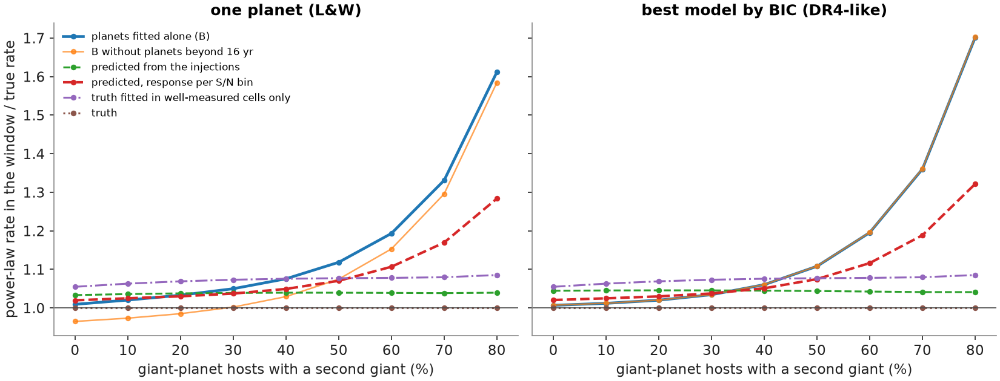
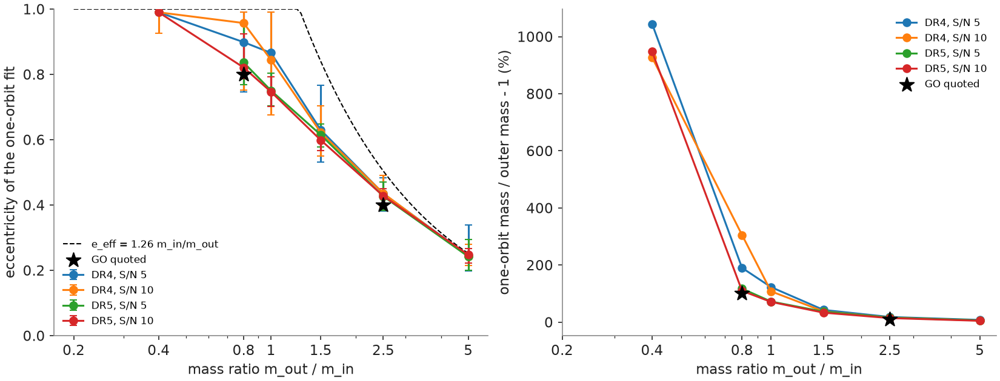
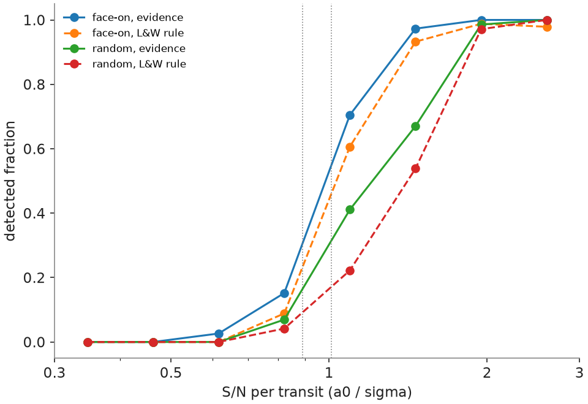
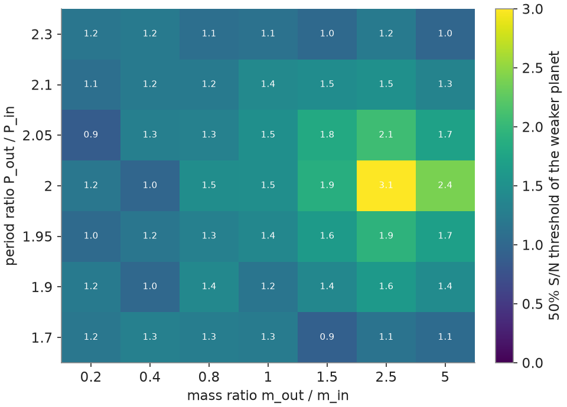

# Gaia DR4 and multi-planet systems: questions, methods and results

## About this document

This document describes the science questions behind this code, the method used to answer each of them, every important assumption and number, where each number came from, and the results. It is organised around the main questions. Where a value or rule was taken from Lammers & Winn, the section or equation number is given. The paper is cited as **L&W**: C. Lammers and J. N. Winn, "On the Exoplanet Yield of Gaia Astrometry", The Astronomical Journal 171:18 (2026), arXiv:2511.04673.

## The science questions and the short answers

### Background

Gaia measures the position of each star many times over several years. Each measurement is one-dimensional: the position along the direction Gaia is scanning at that moment (the along-scan direction). A star moves on the sky because of its own motion (proper motion), because of Earth's orbit (parallax), and, if it has planets, because of a small orbital wobble around the system's centre of mass. Gaia Data Release 4 (DR4, expected December 2026) contains about 5.4 years of data and, for the first time, the individual measurements (epoch astrometry) of all stars.

L&W is the reference forecast of the DR4 planet yield (7,500 ± 2,100 planets). Their simulations assign at most one planet per star (L&W Section 4.2), and in Section 6.2 they state that they have not investigated systems with more than one planet, how hard such systems are to distinguish from single-planet systems, or how accurately the parameters can then be recovered. Real systems often have more than one giant planet. This project fills that gap.

### The six questions

- **Q1. Detection.** Does a second, unmodelled planet make a Gaia-detectable planet harder (or easier) to detect?
- **Q2. Accuracy and warnings.** Does it make the fitted orbit wrong (period, mass, eccentricity), and would Gaia's own quality indicators warn the user?
- **Q3. DR4's alternative models.** DR4 publishes, besides the one-companion orbit, an orbit plus acceleration, an orbit plus jerk and a two-companion orbit. Does fitting these models, and choosing between them, solve the problem?
- **Q4. Occurrence rates and yield.** How much does multiplicity bias the giant-planet occurrence rate that will be inferred from DR4, how does that depend on how common multi-giant systems are, and how does it change the number of planets DR4 will report?
- **Q5. RUWE.** Can multiple planets push a star's RUWE above 1.4, so that the common practice of removing RUWE > 1.4 stars removes planet hosts?
- **Q6. Follow-up.** Which DR4 planets should be distrusted, using only what DR4 publishes, and how efficiently can radial-velocity observations confirm them or reveal a hidden second giant?

### Short answers

- **Q1.** Yes. For a planet that Gaia detects 80% of the time on its own, an unmodelled companion lowers detection to 69% when fitted with one orbit (step 2). Companions with periods similar to the DR4 time span (3.8 to 11 yr) are the most harmful: the planet is then found correctly only 24% of the time.
- **Q2.** Yes. 19% of the planets reported by a one-orbit fit are wrong (neither planet's true orbit). 99% of these pass Gaia's DR3 goodness-of-fit cut (F2 < 25). DR4's own label for weak orbits (OrbitalPoorlyConstrained, significance < 5) would flag only 55 to 60% of them; the rest would be published as normal orbits.
- **Q3.** Largely. Choosing among DR4's models by the Bayesian information criterion raises correct recovery of the planet from 52% to 69% of systems with a companion. The two-companion model helps most for companions with periods under about 11 years; acceleration and jerk models help most for slower companions with a larger wobble. False alarms stay near 1%.
- **Q4.** It depends on how often giant-planet hosts have a second giant (f). With the same true occurrence rate at every f, over the whole sky within 250 pc: in the part of parameter space Gaia measures well (3 to 13 M_J, 1 to 8 yr), the bias is small (0 to −10% relative to the same planets fitted alone, and within 7% of the truth). For the occurrence rate over the whole giant-planet range (0.3 to 13 M_J, 0.1 to 8 yr), obtained by fitting a power law, a one-orbit analysis underestimates the rate by 4% at f = 10%, by 32% at f = 60% (close to the multiplicity measured by Bryan et al. 2016) and by 47% at f = 80%. Using DR4's model choice reduces these to 1%, 9% and 12%. The full-range numbers depend on the assumed shape and on a population-averaged completeness, so the well-measured rate is the primary result. At a fixed true occurrence rate, higher multiplicity lowers the DR4 yield: from about 12,300 to 9,400 reported planets (one-orbit fits) or 10,100 to 8,100 (model choice) between f = 10% and 60%, for stars within 250 pc with RUWE ≤ 1.4. Populations with nearly coplanar, dynamically stable systems or with low eccentricities give the same well-measured result.
- **Q5.** Almost never. Planets alone push RUWE above 1.4 for only 0.5% of stars with one giant and 0.8 to 0.9% of stars with several. The 14% of nearby stars with RUWE > 1.4 are therefore overwhelmingly stellar or brown-dwarf binaries, and the RUWE cut removes fewer than 1% of planet hosts.
- **Q6.** Four flags visible in DR4 (an adopted model other than a plain orbit, significance below 5, period above 0.7 of the time span, eccentricity above 0.5) together mark 55 to 62% of DR4-like planets as suspect and catch 76 to 78% of the inaccurate planets and 97% of the spurious ones; a planet without any flag is inaccurate in 20 to 22% of cases (against 48 to 50% with a flag). Radial velocities confirm almost every Gaia orbit cheaply (94 to 95% with 10 HARPS epochs or fewer), but most DR4 hosts are faint (median V ≈ 13.5): for suspect planets on stars with V ≤ 12 (about 1,400 to 1,800 over the whole sky), a hidden giant is found with 20 HARPS epochs or fewer over 3 years in 69 to 87% of cases.

## Tests

The code has 60 automated tests. Highlights:

- Kepler solver, Kepler's law (Jupiter and the Sun), mass inversion, Thiele-Innes conversions, superposition of two planets, stability rule (reproduces L&W's Section 6.2 example).
- A noise-free planet is fitted exactly (χ² below 1e-12); with noise only, χ² averages N − 5.
- Orbit + acceleration and two-planet fits recover planted signals; the two-planet fit gives a small gain for a single planet.
- BIC model choice, step 2 outcome rules, RUWE (equals 1 for pure noise), significance (matches a Monte Carlo).
- Occurrence model (CLS normalisation), multiplicity scenarios (Bryan calibration, same mean rate, stability), Gaia star selection cuts, L&W's distance limit, download query formats.
- Rate estimators: recovery of a known power law; and a toy survey with noisy fitted masses and periods, which shows that counting detections at fitted values with a completeness measured at true values is biased by more than 15% in some bins, while the corrected estimators recover the truth (within 3% in total).
- Multiplicity reweighting reproduces the requested fraction of multi-giant hosts.
- Gaiamock-based tests (run only where Gaiamock is installed): our simulated wobble equals Gaiamock's to 1e-9 mas; our χ² and F2 equal Gaiamock's to 1e-12; our optimiser and σ_P match Gaiamock's; RUWE and σ_a0 agree with Gaiamock's.
- Real-data tests on the DR4 pre-release: file reader, single-star parallax, independence of CCDs within a transit, and recovery of three published orbits; the per-transit DR4 input pipeline reproduces the per-CCD fits.
- Population variants (coplanar, low eccentricity) and the N-body stability screen (a stable pair passes, a crossing pair fails).

## Step 1: single planets, compared with L&W

### Setup

10,000 single planets with SNR1 (wobble ÷ per-transit noise) log-uniform from 0.1 to 5 and period log-uniform from 50 days to 3T; G uniform 8 to 15; star mass 0.4 to 1.3 M_sun; parallax 2 to 100 mas; random orientations.

### Results

- **Δχ² against SNR1:** Δχ² ≈ 21 to 24 × SNR1², matching L&W Eq. 31 for DR4 (≈ 22 SNR1²). Our χ² equals Gaiamock's to 1e-13.
- **Threshold:** detection is 50% at SNR1 = 1.79, consistent with L&W's "Δχ² > 50 corresponds to SNR1 ≳ 1.5" once noise scatter is included.
- **Longest periods:** detection (for SNR1 > 3) falls below 50% at P/T = 0.93, about 5.0 years.
- **Period-error limit (L&W's definition):** L&W define the DR4 period limit (4.0 yr) as the period where the mean relative period error of recovered orbits reaches 20% (L&W Section 3.1, Fig. 10). Our value, for planets with SNR1 > 3: the mean period error reaches 20% at P/T = 0.80, i.e. 4.3 years (the median error reaches 20% at 5.9 years). This agrees with L&W's 4.0 years to within 8%. L&W's 4.0-yr limit and our detection limit (5.0 yr) measure different things: planets with periods of 4 to 5 years are often still detected, but with poorly measured periods.
- **Mass bias near threshold:** detected masses are biased high near the detection limit (median +11%, 84th percentile +65%), because a weak planet is detected mostly when noise makes its signal look larger. This is the Eddington bias, which also appears in steps 2 and 3.
- **Period rule check:** on 15 systems near the data-span limit, Gaiamock's MCMC gave the same period widths as our linearised rule (median ratio 1.00); our rule is if anything slightly stricter.

## Step 2: one hidden companion (Q1 to Q3)

### Design

- 20,000 simulated two-planet systems. The **target** planet is detectable on its own: SNR1 log-uniform 1.5 to 10, period 100 days to 0.7T (3.8 yr), mass 0.3 to 13 M_J, Kipping eccentricity. The **companion** has a period log-uniform from 30 days to 10T (54 yr), inside or outside the target, and a wobble ratio (companion's wobble ÷ target's) log-uniform from 0.01 to 100; its mass, which must be 0.3 to 13 M_J, follows from these. Orientations are random and independent. Every pair must be Hill stable (separation > 2√3 mutual Hill radii at closest approach; Gladman 1993).
- Stars: G 8 to 15, 0.4 to 1.3 M_sun, parallax 2 to 100 mas, random sky positions (so realistic numbers of transits).
- **Paired design:** each system is analysed twice with identical observation times and noise, once with the target alone and once with both planets. Any difference is caused by the companion; the near-threshold mass bias cancels.
- Analyses: one planet, + acceleration, + jerk, two planets, and best model by BIC.
- **Outcomes:** target correct (period within 10% and mass within 20% of the target-alone result, or of the truth if that was not detected), companion correct, wrong (a reported planet matching neither), acceleration or jerk only, nothing.
- These percentages describe kinds of companions spread evenly in log period and log wobble ratio, not a real population; the population weighting is step 3.

### Results for Q1 (detection)

- One-planet fit: the target is detected in 80.2% of systems when alone and 68.6% with the companion (3,002 detections lost, 670 gained).
- Weak companions (wobble less than about a third of the target's) and slow companions with a smaller wobble are harmless (target correct 80% and 72%, the same as without the companion).
- Companions with a period below 3.8 yr and a strong wobble: target correct 28%.
- Companions with periods of 3.8 to 11 yr (similar to the data span): target correct 24%, the worst case.
- Companions slower than 11 yr with a larger wobble: target correct 46%.
- Besides the companion's period and wobble, what matters most is the target's own signal strength, then the number of transits and the target's eccentricity; the companion's orientation hardly matters.

### Results for Q2 (wrong orbits and warnings)

- Of the planets reported by the one-planet fit with a companion present: target correct 75.6%, companion correct 5.8%, wrong 18.7%.
- 98.9% of the wrong planets pass the DR3 cut F2 < 25. The reason is that F2 is computed on per-CCD data, where a model error is diluted about 8 times.
- DR4's significance label: of the systems with a wrong planet, 46% (one-planet fit) and 41% (best model by BIC) would be published as normal orbits (significance ≥ 5); the rest would be labelled OrbitalPoorlyConstrained.

### Results for Q3 (DR4's alternative models)

Percentage of all 20,000 systems in mutually exclusive categories (each system counted once, so each row adds up to 100%): both planets correct / target only / companion only (target missed) / a correct planet plus a wrong one / wrong planet only / acceleration or jerk only / nothing reported, with the false-alarm rate on the target-alone data in brackets. A planet of some kind is reported in the first five categories together (68.6% for one planet, 78.9% for the BIC choice).

| Analysis | Both | Target only | Companion only | Correct + wrong | Wrong only | Acc./jerk only | Nothing | [False alarm] |
|---|---|---|---|---|---|---|---|---|
| One planet | 0.0 | 51.8 | 4.0 | 0.0 | 12.8 | 0.0 | 31.4 | [0.8] |
| One planet + acceleration | 0.0 | 61.7 | 3.2 | 0.0 | 10.0 | 0.0 | 25.1 | [0.9] |
| One planet + jerk | 0.0 | 63.5 | 2.6 | 0.0 | 8.9 | 0.0 | 24.9 | [0.8] |
| Two planets (if justified) | 5.2 | 55.3 | 1.2 | 4.4 | 11.0 | 0.0 | 23.0 | [1.0] |
| Best model by BIC | 5.1 | 61.4 | 1.2 | 2.8 | 8.3 | 0.6 | 20.6 | [1.0] |

"Target correct" in the text below counts every system where the target is found, whether or not a second planet is also reported (for the BIC choice 5.1 + 61.4 + part of 2.8 = 68.6%). Version 0.1.0 of this document listed target correct, companion correct and wrong planet as overlapping shares, so the two-orbit and BIC rows added up to more than 100%. The table is made by scripts/extended/g2_step2_exclusive.py.

By kind of companion, target correct with one planet → best model by BIC:

- Period < 3.8 yr, weak wobble: 80% → 79%.
- Period < 3.8 yr, strong wobble: 28% → 53% (the two-planet model chosen in 75% of these; both planets found correctly in 28%).
- Period 3.8 to 11 yr: 24% → 63%.
- Period > 11 yr, smaller wobble: 72% → 73%.
- Period > 11 yr, larger wobble: 46% → 68% (acceleration or jerk models chosen in 56%).

The BIC choice adopts a model other than one planet in 53% of systems with a companion and 10% of systems without one. Both planets are found correctly in 5% of all systems (28% for strong short-period companions). A known limitation: the sequential two-planet search can lock onto a blended first orbit when the two planets have similar wobbles near a 2:1 period ratio.

### Posterior examples

For three example systems (no planet; a 3 M_J planet at 1.5 yr; the same plus a 1.9 M_J companion at 15 yr) the posterior distributions were sampled with an ensemble MCMC sampler (Goodman and Weare stretch moves; the linear parameters are marginalised analytically; 32 walkers × 2,500 steps for one-orbit models, 64 walkers × 20,000 steps for the two-planet model) and shown as corner plots (command: python scripts/step2.py examples). With the companion present, the one-planet model gives a mass spread over 5 to 20 M_J, tied to eccentricities near 1; the acceleration model recovers about 3 M_J and is the one BIC adopts; the two-planet model places the second orbit at about 27 years with about 200 M_J, because a companion much slower than the time span only shows as curvature. Without a planet, the one-planet model finds only noise solutions (Δχ² = 24) and BIC adopts no planet.

## Step 3: real Gaia stars, occurrence rates and yield (Q4, Q5)

### Stars

- Every Gaia DR3 source over the whole sky with parallax > 4 mas (closer than 250 pc) and parallax/error > 10: 3,691,994 sources. They are downloaded in 768 pieces, one per HEALPix level-3 tile (53.7 deg²). Gaia source_ids encode the HEALPix level-12 pixel of the source, so each tile is a range of source_ids, which the archives read without scanning the whole table.
- Selection (L&W Section 4.1): main sequence, 0.4 < M_G − 2.9 (BP − RP) < 4.5 (L&W Eq. 38): 3,239,757; closer than L&W's distance limit r_max(M_G) (Eqs. 36, 37) and 250 pc: 3,023,444; M_G ≤ 12 (mass relation valid, M > 0.2 M_sun): 2,699,125; RUWE ≤ 1.4: 2,311,408 (387,717, 14%, removed).
- All 2,311,408 selected stars are used. Star masses from Gaia FLAME where available (23%), otherwise from M_G with the main-sequence mass-magnitude relation (as L&W).
- Whole-sky numbers (yields, numbers of planets) are counted directly, not scaled from a sky fraction.

### Planets

- Occurrence model: L&W Eq. 23 (CLS-normalised Fulton et al. 2021 shape), 0.3 to 13 M_J and 0.1 to 30 au, scaled with stellar mass; Kipping eccentricities; random, independent orientations. On these stars this gives 0.20 giants per star over the full range and 0.102 per star in the window 0.3 to 13 M_J, 0.1 to 8 yr.
- **Two multiplicity scenarios with the same mean number of giants per star:**
- Independent: each star gets a random (Poisson) number of giants, independently. 412,430 stars host a giant; 12% of them have two or more.
- Clustered: only a fraction of stars can host giants, and those host more. Calibrated so that a giant host has an outer giant companion (1 to 13 M_J, 5 to 20 au) with the probability measured by Bryan et al. (2016), scaled to our mass range. 214,269 stars host a giant; 59% of them have two or more.
- Every multi-planet system must be Hill stable; an unstable planet is redrawn and, if that fails, dropped. Two variants of the population (systems made dynamically stable and nearly coplanar from the start; low eccentricities in multi-planet systems) test these assumptions ("Population variants" below).

### Design

- **A:** every star with all its planets (what Gaia sees).
- **B:** each planet alone on its star, with the same observations and noise (the reference with no multiplicity). A − B isolates the effect of planets sharing a star.
- **I:** 50,000 single injected planets (log-uniform in mass and in period from 0.05 to 16 yr, hosts chosen in proportion to stellar mass), used to measure the completeness as a DR4 user would.
- **V:** 400 systems per scenario just below the pre-fit cut (summed SNR1 0.5 to 0.8), to confirm that systems below the cut are not detectable: 0 of 400 were.
- **N:** 1,500 stars without planets, for the RUWE of single stars.
- Each A, B, V and I system is fitted with all four DR4 orbit models, and the best model by BIC is derived from those fits: 190,896 (independent) and 138,986 (clustered) stars are fitted. The DR4 RUWE (and a DR3 RUWE, from DR3 observation times) is computed for every star. The whole run takes about 1,100 core-hours.

### How occurrence rates are inferred

- Bins: mass 0.3, 1, 3, 13 M_J; period 0.1, 0.3, 1, 2, 4, 8 yr. Rate in a bin = detections ÷ (number of stars × completeness).
- **Bin migration.** Near the detection limit the fitted mass and period scatter away from the true values, and detected planets are mostly those whose signal fluctuated up (Eddington bias), so planets migrate between bins. The completeness is therefore measured with the injected planets counted at their fitted parameters (detected in fitted bin ÷ injected in true bin). Only bins with completeness ≥ 5% are used (3 to 13 M_J at 1 to 2, 2 to 4 and 4 to 8 yr): the **well-measured region**.
- **Power law** over the whole window (0.3 to 13 M_J, 0.1 to 8 yr), Γ = C m^α P^β per ln m per ln P, fitted by forward modelling: the expected detections in each fitted cell are predicted through the injection response matrix (true cell → fitted cell, with true cells extending from 0.05 to 16 yr), and compared with the detections by a Poisson likelihood. The rate is Γ integrated over the window.
- **Closure test:** with each planet alone (B) in the independent scenario, the power law recovers the true rate to within 1% (one planet and best by BIC), and the well-measured bins to within 1 to 4%.
- Reported planets are also classified as **correct** (period within 10%, mass within 20% of a real planet), **imprecise** (a real planet measured loosely: period within a factor 1.5, mass within a factor 2) or **spurious** (no real planet resembles it).

### Results: the two scenarios

- **Independent multiplicity:** well-measured bins, one-planet fit: A +2.9%, B +4.4% relative to the truth (A vs B −1.5%); best by BIC: A +0.1%, B +1.0% (A vs B −0.8%). Power law, one planet: A 0.0952, B 0.1015, truth 0.1019 planets per star (A −6.6%); best by BIC: A 0.0996 (−2.3%), B 0.1012.
- **Clustered multiplicity:** well-measured bins, one planet: A −7.5%, B +0.7% (A vs B −8.1%); best by BIC: A −7.5%, B −3.0% (A vs B −4.6%). Power law, one planet: A 0.066 against a truth of 0.096 (−31%); best by BIC: A 0.085 (−11%).
- The deficit is concentrated at short periods and lower masses (for example 3 to 13 M_J at 0.3 to 1 yr), where the completeness is low: the companion of an inner giant is usually an outer giant with a larger wobble, which spoils the fit of the inner one. The power law, which relies on these detections for its shape, carries the deficit over to the whole giant-planet range.
- **Accuracy of reported planets** (independent): one planet correct 54%, imprecise 32%, spurious 14%; best by BIC 63%, 32%, 5%. The split is the same in A and B, so most inaccurate planets come from being near the detection threshold, not from multiplicity. With clustered multiplicity, A finds 11% (one planet) and 6% (BIC) fewer real planets than B.

### Results: multiplicity scan (Q4)

- **Method (no new fits).** Each star's result depends only on its own planets, so a population with any fraction f of giant hosts having two or more giants can be assembled by reweighting the fitted host stars of both scenarios. The number of giants per host follows a zero-truncated Poisson distribution whose parameter sets f. The weights are applied separately in four bins of stellar mass, and the fraction of stars hosting giants is set so that the number of giants per star in the window (0.3 to 13 M_J, 0.1 to 8 yr) equals the CLS-calibrated value (0.102 per star) in every stellar-mass bin. Every f therefore has the same true occurrence rate. Uncertainties are bootstrap 16 to 84% ranges of this simulation (resampling hosts and injections), not DR4 statistics. At f ≥ 0.6 a small tail of very crowded systems (1 to 6%) is not represented in the simulated hosts.
- **Well-measured bins** (3 to 13 M_J, 1 to 8 yr), inferred ÷ true at f = 0 / 10 / 30 / 60 / 80%: one planet 1.07 / 1.06 / 1.03 / 0.99 / 0.93; best by BIC 1.04 / 1.03 / 1.01 / 0.98 / 0.93. Relative to the same planets fitted alone (B): one planet 1.00 / 0.99 / 0.97 / 0.93 / 0.90; best by BIC 1.00 / 0.99 / 0.98 / 0.96 / 0.95. The effect of multiplicity here is 0 to −10%.
- **Occurrence rate over the whole window** (power law), inferred ÷ true: one planet 1.01 / 0.96 / 0.85 / 0.68 / 0.53; best by BIC 1.01 / 0.99 / 0.96 / 0.91 / 0.88.
- **Planets alone (B), power law:** 1.01 at f = 0, rising to 1.19 (one planet) and 1.20 (BIC) at f = 60% and 1.61 and 1.70 at f = 80%, while the binned B rate stays at 0.99 to 1.07. The cause is the completeness, not the population shape ("Why the power law of planets alone drifts" below), so the full-range numbers are model-dependent and the well-measured rate is the primary result.
- **Yield** (planets reported, stars within 250 pc with RUWE ≤ 1.4, whole sky), at f = 0 / 10 / 30 / 60 / 80%:
- One planet: 12,900 / 12,300 / 11,200 / 9,400 / 7,700; of which real planets (correct + imprecise) 11,100 / 10,600 / 9,600 / 8,100 / 6,600.
- Best by BIC: 10,500 / 10,100 / 9,400 / 8,100 / 6,900; real planets 10,100 / 9,700 / 9,000 / 7,700 / 6,600.
- At a fixed true occurrence rate, more multiplicity means fewer detections: the same planets sit on fewer stars, and each one is harder to fit.

### Comparison with L&W's yield

L&W predict 7,500 ± 2,100 DR4 giant planets with at most one planet per star. Our full-fit yield is higher. Restricting the sample to 250 pc does not explain this, since it removes stars that L&W include; 35% of our detections (L&W rule) come from 150 to 250 pc. Counting the same simulated planets (independent scenario) in steps (scripts/extended/g1_lw_yield.py):

| Step | DR4 planets, whole sky |
|---|---|
| Our full orbit fits, one planet (all reported planets, periods up to 8 yr) | 11,872 |
| Counted with the L&W rule instead (SNR_1 > 1.5 and P < 4 yr) | 10,986 |
| Also with L&W's noise (54 µas per transit at G < 14, against a median of 46 µas in the gaiamock table) | 9,425 |
| L&W (2026), Galaxy model of stars | 7,500 ± 2,100 |

- The first step reflects what is counted: full fits also report planets at 4 to 8 yr and some imprecise or spurious solutions. The second is the noise model.
- The remaining difference (26%) is within L&W's quoted uncertainty. It may come from the stellar sample (real Gaia stars here, a model population in L&W); this has not been tested separately.
- With clustered multiplicity the same counting gives 7,085.

### Results: RUWE (Q5)

- Stars without planets: RUWE > 1.4 in 0.00% (1,500 stars).
- Independent scenario: RUWE > 1.4 for 0.50% of stars with one giant and 0.77% of stars with two or more (DR3 RUWE: 0.14% and 0.16%).
- Clustered scenario: 0.51% and 0.90%.
- RUWE > 1.4 is reached mainly by strong, short-period signals; long-period planets are partly absorbed into the proper motion.
- Conclusion: removing stars with RUWE > 1.4 removes fewer than 1% of planet hosts, and multi-planet systems are not preferentially removed. Stellar and brown-dwarf companions, which cause most of the observed RUWE > 1.4 cases, are not in the reference population.

## Step 4: warning signs and radial-velocity follow-up (Q6)

### Design (scripts/step4.py)

- Uses only the step 3 results (the fits of the real-star sample); no new Gaia fits. It runs in minutes.
- Planets analysed: every planet reported for the real systems (A) by the best model by BIC (what DR4 would publish) and, for comparison, by the one-planet fit, in both multiplicity scenarios.
- **Flags** use only quantities a DR4 user can see: the adopted model (other than a plain orbit), significance below 5 (OrbitalPoorlyConstrained), period above 0.7 T (3.8 yr), eccentricity of the one-planet fit above 0.5, Δχ² below 100 (near threshold), period error above 10%, RUWE above 1.2. A planet is **suspect** if any of the first four flags is set.
- For each flag: share of planets flagged; share inaccurate (imprecise or spurious), spurious, and with a hidden giant (another giant of 0.3 to 13 M_J at 0.1 to 30 au on the star that was not reported), among flagged and unflagged planets; and the share of all inaccurate, spurious and hidden-giant cases that the flag catches.
- **Radial velocities** (src/gaiabias/rv.py; all numbers are simple, documented assumptions):
- Semi-amplitude K = 28.43 m/s × m sin i/M_J × (P/yr)^(−1/3) × (M*/M_sun)^(−2/3)/√(1 − e²), using the true inclinations.
- V magnitude from G and BP − RP (Gaia DR3 relation of Riello et al. 2021), with BP − RP from M_G along the main-sequence locus used in the selection.
- Precision per epoch: HARPS 1.0 m/s at V = 8 in 900 s (floor 0.5 m/s); FEROS 5.0 m/s at V = 8 in 1200 s (floor 4 m/s); photon noise scaling as 10^(0.2(V − 8)); stellar jitter 2 m/s (M* > 0.6 M_sun) or 3 m/s (M dwarfs); 300 s overhead per epoch. Practical faint limits V ≤ 12 (HARPS) and V ≤ 10 (FEROS).
- Epochs for a 5σ result: to confirm a Gaia orbit (period known) N = 2(5σ/K)²; to reject a spurious orbit, the same with the difference between predicted and true signals; to detect a hidden giant over a 3-year programme, as an orbit (N = 2(5σ/K)², at least 8) when its period is shorter than the programme, otherwise as a trend (N = 12(5σ/Δv)², with Δv the typical velocity change over the programme). At least 6 epochs always.

### Results: warning flags

Best model by BIC, independent / clustered multiplicity. Reported planets over the whole sky: 9,793 / 7,115; inaccurate 37% / 38%; spurious 5% / 4%; star hides another giant 23% / 80%.

- **Significance < 5:** 18% / 18% of planets; inaccurate 76% / 77% of flagged against 28% / 29% of unflagged; catches 66% / 71% of spurious planets.
- **Eccentricity > 0.5:** 26% / 27%; inaccurate 65% / 62% against 27% / 29%; catches 68% / 71% of spurious planets.
- **Near threshold (Δχ² < 100):** 29% / 27%; inaccurate 57% / 59% against 28% / 30%.
- **Adopted model not a plain orbit:** 7% / 21%; hardly more often inaccurate (48% / 38% against 36% / 38%) but much more often hiding another giant (52% / 96% against 21% / 75%). For the one-planet analysis the same flag (the BIC preferring another model) catches 76% of spurious planets.
- **Period > 3.8 yr:** 29% / 27%; inaccurate 43% / 45% against 34% / 35%. **Period error > 10%:** 9% / 11%; inaccurate 62% / 56%.
- **RUWE > 1.2** marks the more accurate planets (inaccurate 19% / 21% against 44% / 46%), because a high RUWE means a strong signal. It is not a warning sign.
- **Suspect (any of the first four):** 55% / 62% of planets; inaccurate 50% / 48% against 20% / 22%; catches 76% / 78% of inaccurate, 97% / 97% of spurious and 66% / 65% of hidden-giant cases.

### Results: radial-velocity follow-up

- DR4 planet hosts are mostly faint K and M dwarfs: median V = 13.4 (independent) and 13.8 (clustered). Median HARPS precision 12 to 14 m/s per epoch, FEROS 60 to 71 m/s.
- **Confirming the Gaia orbit** is cheap because Gaia planets are massive: 94 to 95% with 10 HARPS epochs or fewer (median 6); 52 to 56% with FEROS. A spurious orbit is rejected with 10 HARPS epochs or fewer in 92 to 95% of cases.
- **Finding the hidden giant** over a 3-year programme with 10 / 20 / 40 HARPS epochs: 43 / 50 / 55% (independent) and 55 / 60 / 64% (clustered) of stars with a hidden giant; with FEROS 19 / 23 / 29% and 30 / 36 / 42%. The others are too slow or too light to show up in 3 years.
- **Within practical reach** (suspect planets on stars with V ≤ 12, HARPS): about 1,800 (independent) or 1,400 (clustered) planets over the whole sky, needing about 6,100 or 5,200 hours of HARPS time in total (at most 40 epochs each); among them, a hidden giant is found with 20 epochs or fewer in 69% or 87% of cases. With FEROS (V ≤ 10): about 720 or 540 planets, 4,000 or 3,300 hours. Only the southern part of the sky is observable from La Silla, roughly halving these numbers for one site.

### Recipe for follow-up

- Distrust first the DR4 planets with significance below 5 or eccentricity above 0.5; these are most often imprecise or spurious, and a few RV epochs decide.
- Look for hidden giants first around stars where DR4 adopted an acceleration, jerk or two-companion model: in the clustered case 96% of them have another giant.
- Restrict precise RV follow-up to V ≤ 12 (HARPS) or V ≤ 10 (FEROS); plan 6 to 10 epochs to confirm the orbit and about 20 epochs over 3 years to look for a companion.

## Extended analyses

Robustness tests, comparisons and forecasts (added in versions 0.2.0 and 0.3.0). The scripts are in scripts/extended/ (see its README); results go to results/extended/. Analyses that use step 3 results use the whole-sky run.

### Noise model (scripts/extended/g2_noise_robustness.py)

The first 1,000 step 2 systems were refitted under four less favourable noise models, always using the reference uncertainties in the fit, as a DR4 user would: CCD measurements within a transit correlated with ρ = 0.05 (the DR4 pre-release gives ρ = −0.001 ± 0.007); an extra error shared by all transits within four days, at half the per-transit error; an unreported excess of 0.03 mas growing by 50% per magnitude fainter than G = 13; and all errors 30% larger than reported.

- The detections lost because of the companion are the same under all five models: 12.6 to 13.8 percentage points (13.4 for the reference model).
- The gain from DR4's alternative models is not: the BIC choice finds the target in 68.3% of systems against 51.5% for one orbit with the reference noise, but 50.7% against 42.9% when the errors are underestimated. Under each alternative the BIC choice reports a wrong planet more often than the one-orbit fit (14.7 to 18.0% against 12.1 to 13.7%). False alarms stay at or below 2.5%.
- Conclusion: the effect of a companion does not depend on the noise model; the reliability of acceleration and two-orbit solutions depends on how well the uncertainties are calibrated.

### Bayesian evidence versus the BIC (scripts/extended/g2_evidence.py, g2_evidence_truth.py)

For 1,543 step 2 systems (478 with a weak target, 518 with an eccentric planet, 47 near the 2:1 period ratio, which is all that the 20,000 systems provide once the other groups are filled, and 500 at random) the evidence of the seven models was computed: the linear parameters are integrated analytically with Gaussian priors and the period, phase and eccentricity of each orbit are sampled with nested sampling (dynesty). All ln Z errors are below 1.

- The two choices agree for 57% of systems (61% in the random group); 65% and 52% with orbit and trend priors three times narrower and wider. When the BIC adopts one orbit, the evidence agrees in 654 of 704 cases; when it adopts an orbit with a trend, the evidence prefers two orbits in 412 of 538; when it adopts two orbits, the evidence prefers one in 82 of 281.
- Against the true systems the BIC does slightly better overall: target correct 62% against 58 to 59% for the evidence, a wrong planet 12% against 15 to 16%. Where the BIC adopts a trend model and the evidence two orbits (350 to 412 systems, depending on the priors), the BIC finds the target more often (65 to 69% against 48 to 52%) and reports a wrong planet less often (10 to 12% against 21 to 24%). In the opposite case (BIC two orbits, evidence one; 53 to 101 systems) the evidence is better (target correct 55 to 64% against 45 to 51%). Neither criterion is better in every case; the boundary between a trend and a second orbit is where the adopted model is least certain.

### Occurrence rate without a power law (scripts/extended/g1_rate_binned.py)

The step 3 inference was repeated with one free rate per mass-period cell and no assumed shape, using the injection response matrix.

- Only cells in which at least 5% of the injected planets are recovered can be measured, all at 3 to 13 M_J. There the rate for the real systems is 0.93 to 1.07 times the truth, and 0.94 to 0.99 times the rate for the same planets fitted alone (both scenarios, one orbit and BIC).
- Cells holding 61 to 67% of the simulated giants, mostly below 3 M_J, have too little response for any rate to be measured without assuming a shape. The large full-range biases of the power-law fit come from extrapolating into these cells.

### Multiplicity from the mix of DR4 solutions (scripts/extended/g1_multiplicity_signal.py)

The share of stars with a reported planet whose adopted model is not a plain orbit (BIC choice) rises from 4.6% when no host has a second giant to 24.6% when 80% do; the share with two orbits alone rises only from 3.4% to 7.3%. Because the first share is observable, it constrains multiplicity: with 3,000 reported planets to about ±0.02 to 0.03 (statistical only; the dependence on the noise model and the selection rule is not included).

### Population variants (scripts/step3.py --variant)

The reference population draws the orientations of the planets in a system independently and accepts any system whose pairs pass the Hill test, which does not guarantee long-term stability for eccentric or inclined pairs. Two variants change only the systems with two or more giants (src/gaiabias/population.py), and step 3 was repeated over the whole sky with each, with the same stars, injections and analysis:

- **coplanar + stable:** every further planet is tilted from the first by a mutual inclination drawn from a Rayleigh distribution with σ = 2° (the scale measured for Kepler multi-planet systems; Fabrycky et al. 2014), and every multi-planet system is integrated with rebound (WHFast, MEGNO) for 10,000 orbits of its innermost planet when it is drawn. A close encounter within one mutual Hill radius, an ejection or MEGNO > 4 makes it unstable, and the whole system is redrawn (up to six times; a system that stays unstable keeps only its first planet).
- **lowecc:** the eccentricities of planets in multi-planet systems are drawn from a Rayleigh distribution with σ = 0.1 instead of Kipping (2013), a bounding case for dynamically cold systems.

Coplanar + stable: 37% (independent) and 38% (clustered) of multi-giant systems are unstable when first drawn (with independent orientations the share is 64% in a 100,000-star test); after redrawing, 110 and 423 systems (0.2 to 0.3%) remain unstable and keep their first planet. Compared with the reference population:

| Quantity | Reference | Coplanar + stable | Low eccentricity |
|---|---|---|---|
| Well-measured rate, A vs B, clustered, one orbit / BIC | −8.1% / −4.6% | −8.6% / −4.3% | −8.6% / −4.8% |
| Well-measured rate ÷ true, one orbit, f = 0 → 80% | 1.07 → 0.93 | 1.09 → 0.97 | 1.10 → 0.99 |
| Power-law rate ÷ true, one orbit, f = 30 / 60 / 80% | 0.85 / 0.68 / 0.53 | 0.92 / 0.75 / 0.65 | 0.89 / 0.70 / 0.58 |
| Power-law rate ÷ true, BIC, f = 30 / 60 / 80% | 0.96 / 0.91 / 0.88 | 1.03 / 0.97 / 0.94 | 0.98 / 0.91 / 0.87 |
| Power-law rate of planets alone (B), one orbit, f = 0 / 60 / 80% | 1.01 / 1.19 / 1.61 | 1.09 / 1.13 / 1.03 | 1.08 / 1.15 / 1.16 |
| Yield, one orbit, f = 0 / 60 / 80% | 12,900 / 9,400 / 7,700 | 13,300 / 9,100 / 7,600 | 13,300 / 10,300 / 8,600 |
| Yield, BIC, f = 0 / 60 / 80% | 10,500 / 8,100 / 6,900 | 10,700 / 7,800 / 6,600 | 10,700 / 8,800 / 7,600 |
| Correct / imprecise / spurious, independent, one orbit | 54 / 32 / 14% | 54 / 32 / 14% | 55 / 31 / 14% |
| Correct / imprecise / spurious, independent, BIC | 63 / 32 / 5% | 64 / 32 / 4% | 65 / 31 / 4% |
| RUWE > 1.4, hosts with 2+ giants (independent / clustered) | 0.77 / 0.90% | 0.74 / 0.91% | 0.90 / 1.09% |
| Suspect flags catch (inaccurate / spurious), BIC, independent | 76 / 97% | 74 / 98% | 75 / 98% |

Both variants leave the main results unchanged: the well-measured rate moves by at most a few percent and stays within about 10% of the truth at every multiplicity, the accuracy of reported planets, the RUWE result and the flags are the same, and the yields change by at most 12% (low eccentricity, at high multiplicity). With low eccentricities the power-law deficit at 30 to 80% multiplicity is slightly smaller with one orbit (0.58 instead of 0.53 at 80%) and the same with the BIC choice; the drift of the planets fitted alone is much reduced (1.08 to 1.16). Low-eccentricity companions are slightly easier to detect, so more of the multi-giant hosts are counted (higher yields at high multiplicity) and slightly more of them exceed RUWE = 1.4. Run time: 16.4 h (coplanar + stable) and 14.9 h (low eccentricity) on 64 cores.

### Why the power law of planets alone drifts (scripts/extended/g1_pl_drift.py)

In the reference population the power-law rate of the planets fitted alone (B) rises from 1.01 to 1.61 of the true rate between f = 0 and 80%, while their binned rate stays near 1. B has no multiplicity in its fits, so the drift had to come from the population or from the method. For each f this script compares power-law fits to: the B detections; the detections the injection response predicts for the true planets; the true planets themselves; and the true planets only in the well-measured cells, extrapolated to the whole window.

- The population shape is not the cause: a power law fitted to the true planets in the well-measured cells and extrapolated gives 1.05 to 1.09 at every f, and one fitted to all true planets gives 1.00.
- Planets beyond the longest injected period (16 yr) make up only 0 to 5% of the B detections and do not change the drift.
- In the well-measured cells the B detections agree with the prediction from the injections (ratio 1.02 to 1.08 at every f). In the poorly measured cells they exceed it by up to 39% at f = 80%. A prediction that uses a response measured separately in bins of each planet's per-transit signal-to-noise removes most of the excess (BIC: ratio 0.99 to 1.11).
- The planets of multi-giant hosts therefore have a different signal-to-noise distribution within a cell than the injections (different host stars), and in cells of low completeness a population-averaged completeness is not adequate. This argues for completeness measured star by star, which is how Study 1 will treat the real DR4 data, and for the well-measured rate as the primary result. In the coplanar + stable population the drift disappears (1.03 to 1.14 at all f), although the power law of B stays 5 to 14% high; with low eccentricities it is much reduced (1.08 to 1.16).

### Comparison with Greenfield & Owen (2026) (scripts/extended/g2_go_checks.py)

Greenfield & Owen (2026) study single and two-planet detection in Gaia data with Bayesian model selection, with emphasis on pairs near 2:1. Their set-up was reproduced where they state it: a 1 M_sun star at 16 pc, proper motion (5, −24) mas/yr, sky position (45°, 45°), 30 µas per field-of-view transit, circular face-on orbits (random inclinations as a second case for single planets), "decisive" evidence (log10 Bayes factor > 2). Epochs come from gaiamock's scanning law at the same position; planet-planet interactions are ignored.

- **Resonance-eccentricity degeneracy.** Circular, coplanar 2:1 pairs fitted with one orbit give the eccentricity of the analytic mapping e_eff = 2^(1/3) m_in/m_out (Greenfield & Owen Eq. 22; Yahalomi et al. 2026) for outer-to-inner mass ratios of 2.5 and above: e = 0.24 at a ratio of 5 (0.25 predicted) and 0.43 at 2.5 (0.50 predicted; Greenfield & Owen quote about 0.4). At a ratio of 0.8 the fit gives e = 0.82 to 0.96 (about 0.8 in their work). The fitted mass exceeds the outer planet's by 5 to 8% at a ratio of 5, 14 to 18% at 2.5 (about 10% in their work) and 110 to 305% at 0.8 (up to 100%; 110 to 117% with DR5-length data). The BIC prefers two orbits in most systems with mass ratios up to 1 (49 to 100% at 1.5, depending on S/N and data length), but rarely at 2.5 and above, where the eccentric single orbit is accepted.
- **Single-planet threshold.** The S/N at which 50% of planets are detected: 0.99 (face-on) and 1.23 (random inclinations) with orbit priors of 0.1 mas, 1.18 and 1.54 with 1 mas; Greenfield & Owen find 0.89 and 1.01 with log-uniform priors on the orbit size. The L&W rule (Δχ² > 50 with the mass and period checks) gives 1.07 and 1.36 on the same planets.
- **Second planet near 2:1.** The S/N of the weaker planet at which it is detected in 50% of systems (log10 Bayes factor of two against one orbit > 2), for period ratios 1.7 to 2.3 and mass ratios 0.2 to 5 (60 systems per configuration): 1.50 near 2:1 (1.95 to 2.05) against 1.14 farther away (1.7 and 2.3) with 0.1-mas priors, and 2.05 against 1.38 with 1-mas priors; the highest thresholds are at exactly 2:1 with the outer planet 2.5 to 5 times more massive (up to 3.5). Greenfield & Owen find 0.5 to 2, higher near 2:1 and when the outer planet is more massive. The BIC needs 1.47 near and 0.96 far, the project's two-orbit rule 1.82 and 1.23. Where the evidence prefers two orbits, the two-orbit fit finds both periods within 10% in 80 to 87% of systems.
- Conclusion: the trends agree; our evidence thresholds are somewhat higher, most of the difference following the prior on the orbit size.

### Warning flags on held-out stars (scripts/extended/g1_flags_heldout.py)

The stars were split at random; thresholds were chosen on one half and scored on the other. The default rule (significance < 5, period > 0.7 T, eccentricity > 0.5) flags 75 to 78% of inaccurate planets on the held-out half; 48 to 50% of flagged planets are inaccurate and 43 to 52% of accurate planets are flagged. Thresholds tuned on the other half (significance < 8, period > 0.8 T, eccentricity > 0.7) raise the recall to 88 to 89% in both scenarios at the same precision, but flag 63 to 69% of all planets (48 to 57% of accurate ones), so the choice is a trade-off rather than an improvement. The number of flags is a usable calibration: inaccurate in 20 to 22% of cases with no flag, 34 to 36% with one, 61 to 70% with two and 84 to 89% with three.

### Brown dwarfs and stellar binaries (scripts/extended/g2_mixed_flags.py, fig_binaries.py)

Brown dwarfs (13 to 80 M_J, 0.6% of stars) and stellar companions (mass ratio 0.1 to 1, Raghavan et al. 2010; 7.7% of stars at periods of 0.05 to 16 yr) were added to random step 3 stars. The photocentre orbit is the primary's reflex orbit scaled by (q/(1+q) − β)/(q/(1+q)), with β the companion's share of the G-band light from the main-sequence mass-magnitude relation, and is simulated as a dark companion with the same angular orbit. The same DR3 RUWE cut is applied.

- Of 3,000 brown dwarfs, 5 are reported with a planetary mass, all just below the limit (median 12.7 M_J). Of 6,000 stellar binaries, 1,014 have a planet-like photocentre orbit (apparent mass below 13 M_J), mostly near-twins; 201 of these are large enough to detect, and 20 are reported as planets after the DR4-like fits and the RUWE cut, with a median apparent mass of 9.2 M_J for companions with a median true mass of about 0.19 M_sun, all as plain orbits.
- At these rates contaminants are 7 to 10% of reported planets. The default flags catch 49 to 60% of them; recall falls by about 4 points, precision rises by 3 to 5 points, and planets with no flag are inaccurate or not planets in 26 to 30% of cases instead of 20 to 22%. A DR4 planet sample therefore needs Gaia RVS velocities or one RV spectrum per target. These numbers rest on 25 simulated impostors and a simple binary population.

### Census of known planet hosts (scripts/extended/g2_census.py)

For every host of a planet with P < 200 d within 200 pc with a known distance, stellar mass and G magnitude (1,214 of 3,987 hosts in the NASA Exoplanet Archive composite table, queried 21 October 2026), outer companions of 0.3, 1, 3 and 10 M_J with periods of 0.5 to 12 yr were injected six times per grid point into simulated DR4 data with the host's own scanning pattern, and fitted with the one-orbit model. Hosts are classed by their inner planets.

| Inner-planet class | Hosts simulated | ≥ 50% detection at P = 3 yr (3 / 1 / 0.3 M_J) | Expected detections at the field rate (68%; 95%) | At 3 × field | Smallest ratio to field at 3σ | Expected 0.3–1 M_J |
|---|---|---|---|---|---|---|
| Hot Jupiters (P < 10 d) | 178 | 43 / 10 / 0 | 4.9 (3–7; 1–10) | 14.6 | 2.4 | 0.1 |
| Warm Jupiters (10–200 d) | 112 | 43 / 11 / 2 | 4.3 (2–6; 1–9) | 12.8 | 2.5 | 0.2 |
| Small planets | 851 | 497 / 262 / 87 | 33 (27–39; 22–45) | 99 | 1.5 | 2.6 |
| Other | 73 | 28 / 7 / 0 | 2.7 (1–4; 0–6) | 8.0 | 2.8 | 0.1 |

A 3 M_J companion with a 3-yr period is detected out to about 100 pc, 1 M_J to about 50 pc and 0.3 M_J to about 20 pc. Saturn-mass companions are expected around fewer than three hosts in any class.

### What DR4 alone measures (scripts/extended/g2_observability.py)

For a 1.0 and a 0.5 M_sun star at 25, 50 and 100 pc, companions of 0.19 to 30 M_J at 0.3 to 30 au were injected and classified as a full orbit (significance ≥ 5, inclination and node measured), a poorly constrained orbit, an acceleration only, or no detection. Full orbits need at least about 2.4 M_J at 1 to 2.4 au for a Sun-like star at 25 pc and 4.5 M_J or more at 50 to 100 pc; for the M dwarf, 1.3 to 2.4 M_J at 25 to 50 pc. Beyond about 5 au DR4 alone almost never gives a full orbit; companions there are seen only as accelerations, with mass and separation degenerate. The grid has about five injections per cell.

### Radial-velocity confirmation (scripts/extended/g1_rv_grid.py)

200 simulated two-year campaigns per grid point from La Silla (target at declination −30°, inclination 60°), with the Gaia orbit as prior, epochs near the predicted RV extremes or at random in the season, and confirmation defined by a free-phase fit at the Gaia period excluding zero amplitude at 5σ. Planning precisions at V = 8: HARPS 1.0, FEROS 5.0, CORALIE 6.0 m/s (floors 0.5, 4, 5 m/s), with 2, 5 or 10 m/s stellar jitter.

- With 10 epochs, FEROS and CORALIE confirm 79 to 100% of 3 M_J orbits within 2 au for V ≤ 10, but fewer than 90% of 1 M_J orbits at every grid point; HARPS confirms 74 to 99% of 1 M_J orbits within 2 au for V ≤ 12 with 2 to 5 m/s jitter.
- Beyond about 3 au a two-year programme confirms at most about 80% of orbits even for 3 M_J at V = 9. One-year orbits are harder because the observing season samples similar phases each year.

## Running at scale

All steps are resumable: each finished fit is written to disk as it completes, and a rerun continues where it stopped.

- **Step 2 (made-up systems):** python scripts/step2.py run -n N -j CORES. Roughly 70 core-hours for 20,000 systems; each system is defined by its seed.
- **Step 3 (real stars):** by default every selected star over the whole sky (about 2.3 million) with --inj-fits injections; about 1,100 core-hours with 50,000 injections (17 hours on 64 cores). --stars N takes a random subset and --sky-fraction a random subset of the HEALPix tiles; --variant selects a population variant; --circles reproduces the 25% sky sample of 3° circles used up to version 0.2.0. The cost grows with the number of fitted stars (about 8% of all stars per scenario) plus the injections.
- **Clusters (SLURM):** python scripts/step3.py --build-only, then one array task per part with --part k/n, then --merge-parts; templates in tools/slurm/. Nothing needs MPI: every fit is independent.
- **Shared servers without a queue:** tools/remote_runs/ is a template for running jobs from a private GitHub repository through a GitHub Actions runner on the server: a pushed job file starts the run, the output is visible on GitHub, and summaries and figures are pushed back. Jobs run at normal priority by default (a job can ask for a lower one) and on a fixed number of cores.
- **Measured speed:** on a two-socket AMD EPYC 7552 server one orbit fit takes 0.49 s on one core; 64 workers run 59 times faster than one, 96 workers 78 times (hyperthreads add about 38% more at 192).
- **Multiplicity scan and step 4** need no new fits; they reanalyse the step 3 fits in minutes (python scripts/step3.py --analyse; python scripts/step4.py --root ... --out ...).
- **Numbers to change** in the code for other assumptions: occurrence model, multiplicity and variants (src/gaiabias/population.py), detection rule (src/gaiabias/step2/outcomes.py), radial-velocity instruments (src/gaiabias/rv.py), multiplicity scan grid (SCAN_F in scripts/step3.py), flags (FLAGS in scripts/step4.py).

## DR4 pre-release check

The DR4 pre-release (June 2026) provides per-CCD epoch astrometry for 12 sources.

- **Noise:** the formal per-CCD errors agree with the Gaiamock table to 5 to 10% at G = 14 to 20; the two bright stars have smaller formal errors than the table.
- **Independence within a transit:** for 6 single stars and 3 quasars, the transit-mean residuals scatter as independent CCDs predict (pooled ⟨z²⟩ = 0.996 ± 0.057; correlation −0.001 ± 0.007, 2σ upper limit 0.014). So σ_transit = σ_CCD/√n holds, and the factor of up to 8 fewer planets that correlated errors would cause does not apply.
- **Fitter on real data:** our orbit fit recovers the published orbits of HD 114762 (P = 83.8 d), Gaia-4 (579 d, 10.8 M_J) and Gaia BH3 (4,184 d, e = 0.73, about 35 M_sun). For Gaia-4 the BIC correctly rejects the acceleration and two-planet models.
- **DR4 data model:** epoch astrometry is per CCD for all sources; the orbit tables contain Orbital, OrbitalPoorlyConstrained (significance < 5) and OrbitalAlternative solutions, and OrbitalAlternativeAcceleration, OrbitalAlternativeJerk and OrbitalAlternativeMultiple solutions "mainly for low S/N systems". Each source has one adopted solution per table. The rules for which sources are processed and which solution is adopted are not given in the data model.

## Real DR4 data: input pipeline (src/gaiabias/dr4.py, scripts/dr4_fit.py)

- **Reading.** Any file with the DR4 data-model columns of the epoch-astrometry table: the pre-release VOTable (read without astropy) or ECSV, CSV or FITS files read with astropy (the format of the bulk DR4 files is not yet published).
- **Per transit.** The CCD measurements of a transit that AGIS used (used_by_agis_al, which excludes the SkyMapper CCD) are combined into their inverse-variance weighted mean, the form used in the simulations; this is justified by the independence of CCDs within a transit measured on the pre-release. Orbit fits use the formal errors; for the single-star model the source's excess noise can be added (--excess).
- **Fits.** scripts/dr4_fit.py fits every source with the seven models of step 2, adopts the lowest BIC and reports planets with the project's detection rule; results are appended per source (resumable) and the work can be split with --part k/n. Host masses come from a given table, the whole-sky DR3 star file (FLAME or the mass-magnitude relation), or the mass-magnitude relation with the 5-parameter parallax.
- **Check on the pre-release.** Per-transit data reproduce the per-CCD results: Gaia-4 b at 579 ± 3 d and 10.8 M_J (adopted model: one planet), HD 114762 at 83.8 d and Gaia BH3 at 4,184 d with e = 0.73 (stellar and black-hole companions, not reported as planets); the single stars and quasars are adopted as no planet.

## Caveats

- Our "best model by BIC" is an assumption about how DR4 chooses between its models; DR4's real processing and acceptance rules are not yet published. A DR3-like pipeline would try orbits only for stars with RUWE > 1.4, which would exclude most planet hosts (Q5); in that case most planets would be found by users fitting the epoch astrometry, which is what our analyses represent. Against the true systems the BIC and the Bayesian evidence do about equally well, with different weaknesses at the boundary between a trend and a second orbit (extended analyses).
- Planet-planet interactions are ignored (orbits are added). In the reference population orientations are independent and only the Hill test is applied; a variant with systems made stable (N-body) and nearly coplanar gives the same well-measured result, while the full-range power-law bias is about 25% smaller (extended analyses).
- Stellar and brown-dwarf companions are not in the reference population. A separate test adds them (extended analyses): stellar binaries with nearly equal components can be reported as planets.
- Completeness averaged over the whole population is not adequate in cells of low completeness (extended analyses, "Why the power law of planets alone drifts"); the full-range power-law rates are model-dependent and the well-measured rate is the primary result.
- Star masses come from Gaia FLAME (23%) or the mass-magnitude relation.
- The occurrence-rate bias depends on the assumed multiplicity; the scan covers 0 to 80% of hosts with a second giant. Within multi-giant systems the period and mass distribution is that of the occurrence model with the stability requirement.
- The period rule is a linearised approximation to L&W's MCMC rule, checked on a small sample.
- The radial-velocity estimates use simple scaling relations for instrument precision, a fixed jitter and idealised sampling; real programmes depend on weather, scheduling and stellar activity. They give the order of magnitude of the effort, not an observing proposal.

## Possible extensions

- Completeness measured star by star (injections into each star's own observations), as planned for the real DR4 data, instead of a population average.
- Stellar and brown-dwarf companions with properties taken from Gaia DR3 non-single-star solutions, in the RUWE and occurrence-rate analysis.
- Planets in binaries (a planet orbiting one star of a binary): the binary appears as a slow curvature over the DR4 span and the planet's signal is diluted by the companion's light; a periodogram of the residuals followed by a joint fit, tested on simulated hierarchical systems.
- Resonant systems with planet-planet interactions (N-body orbits) instead of Keplerian sums, near 2:1.
- Running the pipeline on the real DR4 epoch astrometry: completeness by injection into the real data, and occurrence rates with the multiplicity correction.

## How to reproduce

See the README for installation, the order in which to run the scripts, and the files and figures each one produces.

## References

- Lammers, C. & Winn, J. N. 2026, AJ, 171, 18, "On the Exoplanet Yield of Gaia Astrometry", arXiv:2511.04673.
- El-Badry, K. et al. 2024, Gaiamock, github.com/kareemelbadry/gaiamock.
- Holl, B. et al. 2023a, Gaia DR3 astrometric orbit determination, arXiv:2206.05439.
- Halbwachs, J.-L. et al. 2023, Gaia DR3 astrometric binary star processing.
- Gaia Collaboration 2023, Gaia DR3 summary; Gaia DR4 draft data model and pre-release epoch astrometry (2026).
- Kipping, D. M. 2013, eccentricity distribution of exoplanets.
- Gladman, B. 1993, dynamical stability of two-planet systems.
- Fulton, B. J. et al. 2021, California Legacy Survey occurrence rates.
- Bryan, M. L. et al. 2016, statistics of long-period companions to hosts of known giant planets.
- Goodman, J. & Weare, J. 2010, ensemble samplers with affine invariance.
- Riello, M. et al. 2021, Gaia EDR3 photometric content and validation (G, BP, RP to Johnson V relation).
- Raghavan, D. et al. 2010, ApJS 190, 1, a survey of stellar families: multiplicity of solar-type stars.
- Winters, J. G. et al. 2019, AJ 157, 216, the solar neighbourhood XLV: the stellar multiplicity rate of M dwarfs within 25 pc.
- Speagle, J. S. 2020, MNRAS 493, 3132, dynesty: a dynamic nested sampling package.
- Rein, H. & Liu, S.-F. 2012, A&A 537, A128, rebound; Rein, H. & Tamayo, D. 2015, MNRAS 452, 376, WHFast.
- Cincotta, P. M. & Simó, C. 2000, A&AS 147, 205, the MEGNO chaos indicator.
- NASA Exoplanet Archive, Planetary Systems Composite Parameters, doi:10.26133/NEA13.
- Greenfield, E. J. & Owen, J. E. 2026, Detecting multiple planets in Gaia data using Bayesian model selection, arXiv:2610.07149.
- Yahalomi, D. A. et al. 2026, ApJL, the astrometric resoeccentric degeneracy, arXiv:2512.02007.
- Fabrycky, D. C. et al. 2014, ApJ 790, 146, architecture of Kepler's multi-transiting systems (mutual inclinations).
- Górski, K. M. et al. 2005, ApJ 622, 759, HEALPix.
- Marcussen et al. 2026, near-twin binary impostors among Gaia DR3 substellar candidates, arXiv:2609.08590.
